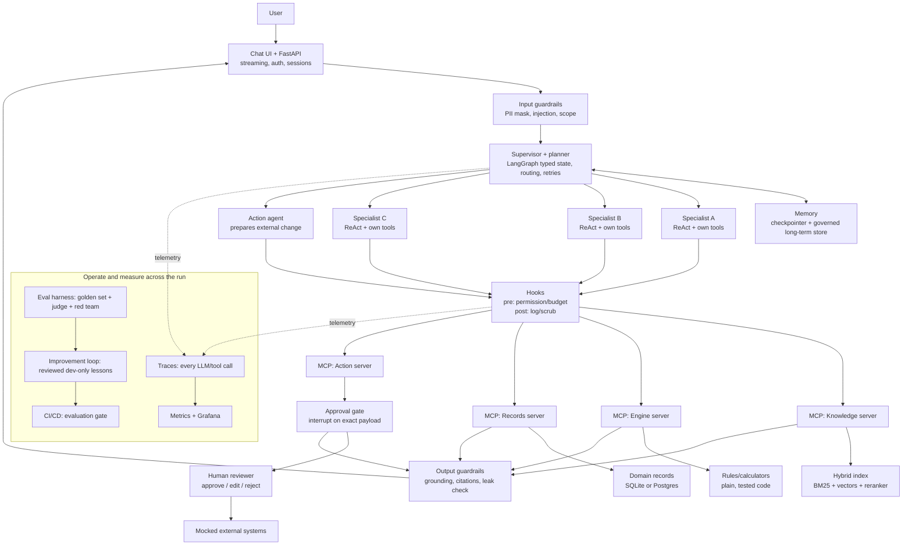
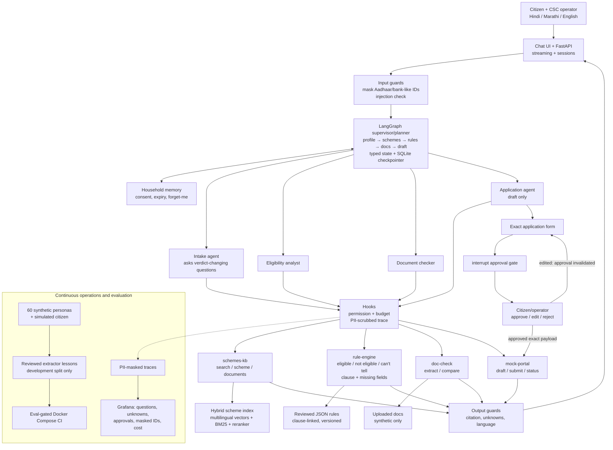
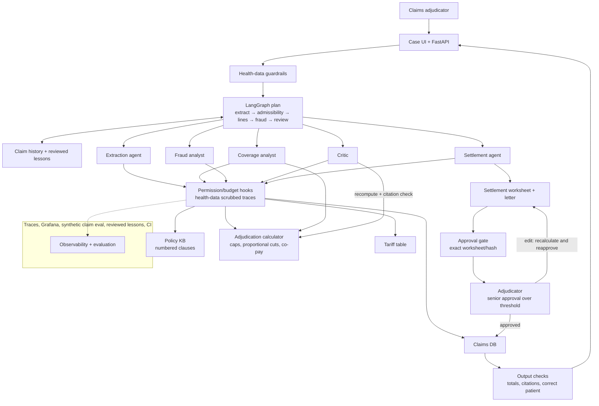
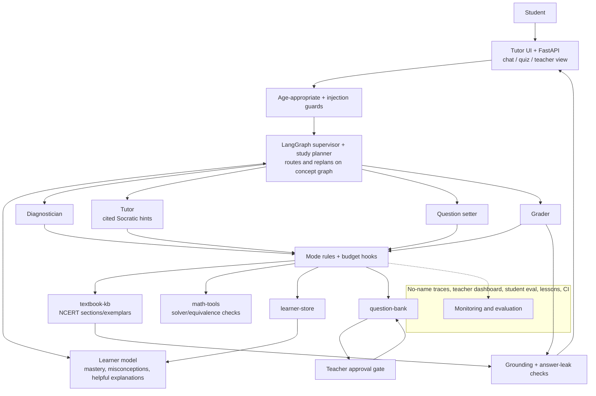
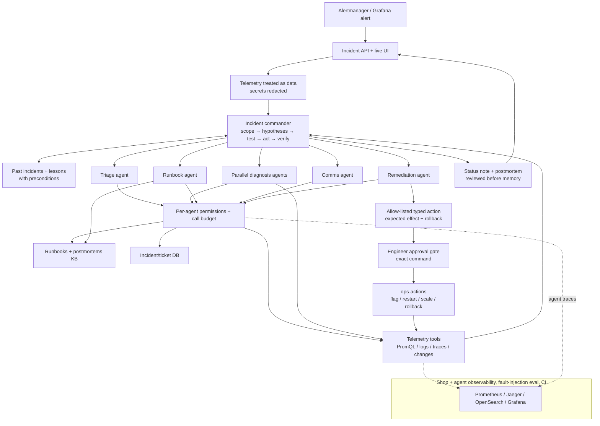
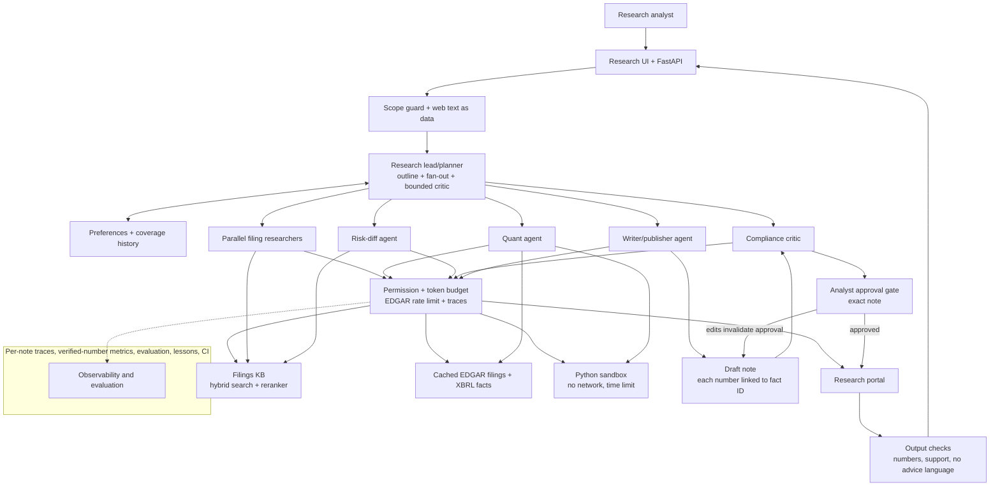

# Capstone project guide — durable reference

This document records a structured, page-referenced understanding of the original capstone PDF supplied in the Saathi workspace (filename: `capstone_projects 2 (1) (1) (1).pdf`; stored in the workspace folder above this repository). It is intended as a working reference for project decisions, implementation, evaluation and the final review. It is a summary and interpretation—not a replacement for the source PDF, its diagrams, or the cohort's separate Capstone Project Guidelines.

## Source and scope

- **Source file:** `C:\Users\Admin\OneDrive\Documents\Saathi\capstone_projects 2 (1) (1) (1).pdf`
- **Title:** *Agentic AI Capstone: Five Full-Stack Projects — Architecture and build guide · Teams of six*
- **Date printed on source:** 16 October 2026
- **Source length:** 17 pages
- **SHA-256 at review:** `21A4B6B279628A2768354AE93A4CF88D10224917CF639CD1D4BB352E91E281EE`
- **Reviewed:** 30 October 2026

This guide says the cohort's separate guidelines control dates, team rules and marking scheme. Where requirements differ or conflict, consult the cohort guidelines and instructor. Requirements below are attributed to PDF page numbers so they can be checked against the original.

## Executive understanding

The capstone is not simply a chatbot with several agents. It asks a six-person team to build and evaluate one honest, working end-to-end system that brings together retrieval, typed tools over MCP, orchestration and planning, memory, multiple agents, a reviewed improvement loop, evaluation, human approval, security, observability and deployment. Teams should build the minimum bar across the system first, then invest deeply in the two project-specific signature challenges. The guide explicitly prefers two or three areas done well over shallow coverage of ten (pp. 1, 3).

For **Scheme Saathi**, the system helps a citizen and/or Common Services Centre (CSC) operator identify potentially relevant government schemes, explain evidence-based eligibility in Hindi, Marathi or English, check documents, and prepare an application. Deterministic, tested code—not the LLM—decides eligibility. A human approves the exact form before any external-world change. The two signature challenges are (A) extracting rules from scheme prose into reviewed, clause-linked JSON and measuring extraction accuracy; and (B) asking the fewest useful questions in three languages while preserving the same verdict for the same persona (pp. 7–8).

## Core architecture and safety principles

### Figure 1 — Reference architecture (PDF p. 2)

The reference diagram is read from the user-facing request down through the system, with operations and measurement spanning the entire flow:

1. User request enters a chat UI and FastAPI service.
2. Input guardrails mask PII, check injection and enforce scope.
3. A LangGraph supervisor/planner operates on typed state, plans and routes work, handles retries, and persists resumable state.
4. Specialist agents use their own tools; short-term state uses a checkpointer and long-term memory stores only policy-governed data.
5. MCP servers expose knowledge search, deterministic rules/calculators, domain records, and separately controlled write actions.
6. Pre-tool hooks check permission and budget; post-tool hooks log and scrub.
7. Any action changing the outside world pauses at an approval gate tied to the **exact payload**. The person may approve, edit or reject. Editing invalidates the previous approval.
8. Output guardrails check grounding, citations and leakage before the response reaches the user.
9. Traces, metrics/dashboard, an evaluation harness, the improvement loop and CI/CD operate alongside the request flow.

The three cross-project rules (p. 2):

- **Model proposes; code and people decide.** Arithmetic, eligibility, money and permissions belong in plain, tested code. The model may select an applicable rule and explain the result.
- **Outside text is data, never instructions.** This includes retrieved passages, uploads, tool results, email and logs.
- **Approve each exact external change.** Bind approval to the payload; any change invalidates it.

The PDF identifies the last agent and last MCP server as the only components that change the outside world, and places them behind human approval.

## Minimum bar for every project (PDF p. 3)

| Lecture area | Required implementation | Evidence at final review |
|---|---|---|
| L4–L6 Retrieval | Ingest with source/date metadata; hybrid BM25 + vectors combined with Reciprocal Rank Fusion; reranker; one query-side technique (rewriting, multi-query, HyDE or decomposition); cite passage IDs. | Recall@5 on 30+ labelled queries, before and after a change. |
| L7 Tools/MCP | At least three FastMCP servers; typed inputs/outputs; structured errors, not crashes; mark read/write and grant write access only where needed. | Tool schemas/list and one test per tool. |
| L8 Orchestration | LangGraph with typed state, conditional edges, a self-correction loop and persistent checkpointer. | Stop mid-run and resume; graph diagram and live demo. |
| L9 Memory | Trim/summarize short-term context; add one long-term store and a policy stating what/when saved, who can read, and correction/deletion method. | One-page policy and memory-on vs memory-off comparison. |
| L10 Planning | Show a plan object; replan when tool results contradict it; use ReAct within specialists. | Trace showing a replan. |
| L11 Multi-agent | Supervisor + at least three specialists, each with own tools and typed hand-off; single-agent baseline with same tools/budget. | Single-agent/team comparison. |
| L12 Improvement | Reflexion on development cases; checker code scores each run, judge only where code cannot decide; reflection turns failures into short lessons with applicability; human reviews each lesson; retrieve relevant lessons only; freeze playbook before held-out evaluation. DSPy optional. | Held-out results before/after playbook, playbook itself, one rejected lesson and reason. |
| L13 Evaluation/monitoring | Golden set 60+ cases, development/held-out split; check outcomes, trajectories and tools; calibrate different-family LLM judge against 20+ human labels; traces for every run; Grafana dashboard. | Evaluation report, judge agreement and dashboard. |
| L14 Human control/hooks | Every world-changing action goes through `interrupt()` with approve/edit/reject; bind approval to exact payload; pre-tool permission/budget checks; post-tool logging. | Live edit invalidates old approval. |
| L15 Security | One-page threat model; input/output guardrails; least privilege; 30+ red-team attacks including injection through own data path. | Attack success with defences off/on and legitimate-work false-block rate. |
| L16 Deployment | FastAPI streaming; `docker compose up` starts app, MCP servers, vector store, Prometheus and Grafana; prompts/model IDs in versioned config; CI evaluation threshold; one working alert. | Clean-machine install and a failed CI run with explanation. |

## Scheme Saathi: intended product and end-to-end journey

### Figure 2 — Scheme Saathi architecture (PDF p. 7)

The diagram connects a citizen/CSC operator and Hindi/Marathi/English chat UI to input/output guardrails, LangGraph supervisor/planner, consent-based household memory, four specialists, an approval gate, four purpose-specific MCP services, a hybrid index, a reviewed JSON rules store, synthetic uploaded documents, a mock portal database, ingestion, and the operations/evaluation/improvement/CI band.

Key named components in the diagram:

- **Supervisor plan:** profile → candidate schemes → rules → documents → draft; typed state and SQLite checkpointer.
- **Specialists:** intake; eligibility analyst; document checker; application agent.
- **MCP services:** `schemes-kb` (search/get scheme/documents), `rule-engine` (`evaluate(profile, scheme)`), `doc-check` (extract/compare), `mock-portal` (draft/submit/status).
- **Data:** hybrid BM25 + bge-m3 index and reranker; extracted, clause-linked, reviewed scheme rules in JSON; synthetic-only document uploads; separate small portal DB.
- **Control/operations:** pre-tool permission/budget and post-tool PII-scrubbed trace; citizen/operator approval; traces; Grafana metrics; 60 personas and simulated citizen; Reflexion lessons for rule extractor; eval-gated Docker Compose CI.

### Numbered walkthrough in the PDF (pp. 7–8)

Example request: a son asks in Hindi what support his 62-year-old widowed mother in Pune with a BPL card can receive and asks for help applying.

1. Mask Aadhaar/bank-like numbers before they reach an LLM or trace; check injection.
2. Show the plan: profile, candidate schemes, rules, documents, draft.
3. Intake forms a typed household profile and asks only high-value questions that resolve open verdicts (e.g. whether she already receives a pension). Stop when verdicts are settled or the user does not know.
4. Search candidate schemes filtered by relevant attributes; deterministic rule engine returns eligible/not eligible/can't tell, the deciding clause and missing fields.
5. List required documents and compare available ones; flag name/date mismatches and explain correction.
6. Application agent drafts on mock portal. Pause on exact form for approval/edit/reject; submission requires token bound to that form.
7. Output guardrails ensure verdicts cite clauses, unknowns are explicit, and reply is readable Hindi.
8. With consent, store household profile with expiry and application ID so follow-up is possible. “Forget my data” deletes all of it.

### Scheme Saathi build specification (PDF p. 8)

- **Data/retrieval:** collect 40–60 schemes (central and one state); sources from myScheme/Digital India Corporation and ministry guidelines; preserve URL and collection date. Split into clauses with scheme/state/date metadata; multilingual embeddings + BM25 + reranker; rewrite colloquial requests into scheme language.
- **Rules signature challenge:** extract eligibility sections into JSON (field, operator, value, source clause); hand-code 15 schemes as gold; measure extraction accuracy; use Reflexion on development schemes to generate error-specific lessons; human reviews before lessons enter instructions and reviews extracted rules before live use. LLM never decides eligibility.
- **Questioning signature challenge:** choose the next question by how many open verdicts it can settle; measure questions/conversation; same persona receives same verdicts in Hindi, Marathi and English.
- **Tools:** `schemes-kb`, `rule-engine`, `doc-check`, and `mock-portal` (draft/submit/status with its own DB). Only application agent gets write-server access.
- **Memory:** pseudonymous household ID, consent flag, expiry and deletion command; justify every stored field.
- **Human/security:** `can't tell` and conflicting documents go to a human caseworker; traces/logs mask personal data; ID numbers only to `mock-portal.submit`; official sources only for rules; refuse requests to misstate income/age.
- **Evaluation:** 60 synthetic boundary-focused personas (e.g. age 59 vs 60 or income just over a limit); two teammates independently label each persona against every candidate scheme; simulated citizen is a different model with a hidden profile card and answers only what it is asked.
- **Ops:** dashboard for questions/chat, `can't tell` rate, waiting approvals, masked-ID hits, cost/conversation; alert on a jump in unknown verdicts.
- **Ablation/demo/red team:** compare direct LLM eligibility with rule-engine boundary errors and planned vs fixed question order; test scam processing-fee page, scheme-text injection, inflated-income requests, cross-household memory access and ID leakage; demo approved draft, refusal to under-report income, scam handling and data deletion (p. 8).

### Important interpretation: “60 personas”

The Scheme Saathi brief's phrase is **60 synthetic personas**—constructed test applicant profiles, not 60 human participants, user roles, UI characters, or 60 independent conversations. They should probe rule boundaries and should have expected outcomes established independently before evaluation. The general project bar asks for a 60+ case golden set divided into about 20 development cases and at least 40 held-out cases (p. 3). The Scheme Saathi section additionally asks for independent double-labeling against every candidate scheme and a simulated citizen with a hidden profile (p. 8). Keep related scenario variants together across splits and prevent the agent from reading held-out cases (pp. 5–6).

## The other four project briefs and their diagrams

These summaries preserve the document's full set of alternatives and cross-project design lessons; Scheme Saathi is Project 1 (pp. 4, 7–8).

### Figure 3 — ClaimSense (PDF pp. 9–10)

Health-insurance claim adjudication. Diagram: claim UI; health-data input/output guardrails; LangGraph extraction/admissibility/line-item/fraud/review/approval flow; extraction, coverage, fraud, critic and settlement agents; exact worksheet approval (two levels over threshold); policy KB, deterministic adjudication calculator, tariff and claims DB; clause-level hybrid index; traces/dashboard/eval/reflexion/CI. Walkthrough checks every bill line against policy clauses, calculates amounts in code, detects duplicates/outliers, has a critic recompute and verify citations, then human approves/edits/rejects; edits recalculate and invalidate approval. Signatures: auditable money calculations (including proportional cuts) and reviewed lessons from adjudicator edits. Uses 80 synthetic claims and hand-checked worksheets; never real patient data. Demo includes injected “pre-approved” text, duplicate detection and invalidation after edit.

### Figure 4 — Socratic Tutor (PDF pp. 11–12)

NCERT tutor for one subject and 3–4 Class 9–10 chapters. Diagram: age-appropriate UI/guardrails; LangGraph study planner over concept graph; learner memory; diagnostician/tutor/grader/question setter; teacher approval for shared question sets; textbook KB, math tools, learner store, question bank; NCERT index; traces/dashboard/eval/reflexion/CI. Flow diagnoses a misconception, retrieves a cited passage, gives hints not answers in practice mode, solver checks questions/answers, updates mastery and study plan; teacher approves new sets and gets alerts. Signatures: learner model changes teaching and teaching effectiveness measured with 40 simulated learners. Evaluation includes 60 gold questions and 20 human-reviewed transcripts; simulated students are not real students. Protect minors and handle distress with a human.

### Figure 5 — On-Call Copilot (PDF pp. 13–14)

Incident response over OpenTelemetry Astronomy Shop (or a smaller injected-fault FastAPI shop). Diagram: Alertmanager + incident API; telemetry-safe guardrails; incident commander; triage, parallel diagnosis, runbook, comms and remediation agents; exact-command approval; runbooks KB, telemetry, tickets, allow-listed ops actions; Prometheus/Jaeger/OpenSearch; traces/dashboard/fault-eval/reflexion/CI. Flow uses telemetry to form/test hypotheses, replans on contradictory evidence, proposes one allow-listed action with expected effect/rollback, requires engineer approval, verifies and rolls back if needed. No shell access; diagnosis agents have no write tools. Eval uses injected faults with known causes, including noisy and dual-fault cases; harmful/unnecessary actions should be zero. Signatures: diagnosis as planning and safe verified/rollback-capable actions.

### Figure 6 — Analyst Desk (PDF pp. 15–16)

Equity research note grounded in public filings. Diagram: research UI; scope/injection guardrails; LangGraph research lead with parallel fan-out, critic and budget; analyst preference memory; filing researchers, quant, risk-diff, compliance critic, writer/publisher; exact-note approval; filings KB, cached EDGAR/XBRL, network-disabled Python sandbox, research portal; traces/dashboard/eval/reflexion/CI. Flow retrieves cited filings, computes margins in code from XBRL fact IDs, compares risk factors, critic checks numbers and support, analyst approves exact note before publishing. Signatures: verify every number and orchestrate deep research efficiently. Compare 10–15 companies across two sectors/three years; 60 research questions; 98% verified-number alert threshold. Respect EDGAR caching/rate limit and fiscal-year/unit differences.

## Evaluation, experimental integrity, roles and deliverables

### Evaluation protocol and experiments (PDF pp. 5–6)

- Build at least 60 cases; write expected outcomes before agent runs; cluster related variants when splitting about 20 development and at least 40 held-out; keep held-out cases inaccessible to the agent.
- Prefer code for database state, amounts, citation existence, tool calls and forbidden actions; use a judge for non-code-checkable qualities. Calibrate a different-family judge on at least 20 human labels and report Cohen's kappa.
- Use one harness with configuration-driven experiments: **E1** fixed/single/team cost-benefit comparison under same model/tools/budget; **E2** defences off/on across attacks and clean cases; **E3** playbook before/after on held-out, including lesson-generation cost and regressions; **E4** project-specific ablation.
- Report successes, policy violations, attack success, false blocks, per-case cost, median and p95 latency, errors, failures and timeouts. Repeat final held-out comparison three times and report spread. If held-out results inform changes, relabel those cases development and disclose it.

### Team roles and separation of duties (PDF pp. 4–5)

Six roles: (1) domain/product lead; (2) knowledge/memory engineer; (3) agents/orchestration engineer; (4) tools/control/security engineer; (5) evaluation/red-team engineer; (6) deployment/operations engineer. Assign owners early and keep contribution log from day one. Role 5 owns held-out cases and attacks; the guide says the person tuning the agent must not write held-out cases and the person building defences must not write attacks; role 1 checks held-out cases against written policy. Everyone should redraw the architecture and explain their own part in the viva.

### Stack and operations (PDF pp. 2, 5)

Suggested defaults: OpenRouter models (fixed IDs in comparisons; stronger supervisor/planner than specialists); judge from another model family; LangGraph with SQLite/Postgres checkpointer and LangGraph store; FastMCP plus langchain-mcp-adapters; stdio in development and HTTP in Docker; Chroma or Qdrant, rank-bm25, cross-encoder reranker; local or multilingual embeddings; layered guardrails (Llama Guard, injection classifier and hook rules); Reflexion lessons reviewed on development cases; pytest/JSONL/checker code and optional RAGAS; LangSmith or self-hosted Langfuse traces; prometheus_client, Prometheus, Grafana; FastAPI streaming, UI, Docker Compose and GitHub Actions. The PDF says no GPU is needed.

### Submission and final review (PDF pp. 6, 17)

Submit repository with one-command startup, redrawn architecture plus numbered walkthrough, threat-model page, memory-policy page, 4–6 page evaluation report, experiment log, contribution log, slides and backup demo recording. Do not commit API keys, private data or materials that cannot be redistributed. Rubric has roughly equal scope/impact, technical depth/execution, presentation and individual viva weight. Be ready to trace one request, distinguish model/code/human decisions, explain the single-agent benefit/cost, cite the experiment that changed design, show missing-evidence/tool-failure/injection traces, explain memory/deletion, demonstrate lesson value on unseen cases, and state prerequisites for a supervised real-user pilot.

## Storage, logs, audit and retention: what the PDF does and does not say

This distinction is important for architecture decisions:

- The PDF **does require observability and logging**: traces for every run (minimum bar p. 3); tracing every LLM and tool call and post-tool hooks that log (reference architecture p. 2); metrics/dashboard and alerts (pp. 2–3); Scheme Saathi traces with PII masked (pp. 7–8).
- It **suggests technologies**: LangSmith or self-hosted Langfuse for traces; Prometheus/Grafana for metrics (p. 5). These are stack defaults/recommendations in the guide, not a mandate for an immutable audit ledger.
- It names **application data stores**: SQLite/Postgres for domain records in the reference diagram; SQLite/Postgres checkpointer and LangGraph store for memory (pp. 2, 5). Scheme Saathi uses consent-based household profile with expiry/deletion, application ID, and a separate mock-portal DB (pp. 7–8).
- It does **not specify** a durable audit-log product, Azure Blob Storage, immutable/WORM retention, retention duration for traces, or a cloud-vendor requirement in this guide. Those require a separate project/security/privacy decision. Azure Blob immutable storage was a design recommendation previously discussed, **not a requirement stated by this PDF**.
- For this project, preserve minimum evidence while minimizing personal data: scrub PII in traces/logs, never retain real applicant records in development, and apply the explicit consent/expiry/forget-me policy to household memory. If a durable audit ledger is added, document its purpose, access, retention/deletion, PII minimization, and whether events are tamper-evident; do not conflate it with observability traces.

## Architecture diagrams — redrawn for this reference

The original PDF contains six diagrams (Figures 1–6, pp. 2, 7, 9, 11, 13, 15). The Mermaid diagrams below are **redrawn structural summaries**, not screenshots: they preserve the components, trust boundaries and principal flows in an editable, version-controllable form. GitHub renders Mermaid in Markdown. Check the cited source page when a visual detail matters.

### Figure 1 — Cross-project reference architecture (source p. 2)

**How to read it:** the model-facing agents do not directly gain arbitrary access to data or side effects. Hooks mediate tool calls. The action route uniquely pauses for a human decision bound to the exact proposed payload. Observability and evaluation are continuous, not a final-response-only feature.

### Figure 2 — Scheme Saathi architecture (source p. 7)

**How to read it:** retrieval finds candidate schemes and evidence; the deterministic rule engine—not the LLM—returns the verdict. `can't tell` and document conflicts remain visible for human handling. Only the application route writes, and submission follows explicit approval of the unchanged form.

### Figure 3 — ClaimSense architecture (source p. 9)

**How to read it:** the model links bill lines to policy clauses, but tested code computes rupee amounts. A critic rechecks totals and evidence. Human edits invalidate old approval; settlement is a gated write.

### Figure 4 — Socratic Tutor architecture (source p. 11)

**How to read it:** learner memory changes what the planner and tutor do. Solver/code checks answers; practice mode avoids complete solutions. Teachers approve shared question sets and receive escalation alerts.

### Figure 5 — On-Call Copilot architecture (source p. 13)

**How to read it:** diagnosis is read-only; only remediation gets typed, allow-listed writes. Every action requires approval, is checked against live telemetry, and can be rolled back. No shell access is provided.

### Figure 6 — Analyst Desk architecture (source p. 15)

**How to read it:** retrieval grounds claims; code computes figures from cached XBRL facts; a critic checks support and calculations; publication occurs only after approval of the exact note.

## Page-by-page index

| PDF page | Contents |
|---:|---|
| 1 | How to use the guide; scope and depth philosophy |
| 2 | Reference architecture, diagram, three safety rules |
| 3 | Minimum bar L4–L16 and evidence |
| 4 | Five projects, coverage matrix, roles 1–4 |
| 5 | Roles 5–6, stack, evaluation protocol start |
| 6 | Experiments E1–E4, reporting, submission, rubric |
| 7 | Scheme Saathi description, Figure 2, numbered flow |
| 8 | Scheme Saathi build details, personas, red team, demo |
| 9–10 | ClaimSense, Figure 3, flow and specification |
| 11–12 | Socratic Tutor, Figure 4, flow and specification |
| 13–14 | On-Call Copilot, Figure 5, flow and specification |
| 15–16 | Analyst Desk, Figure 6, flow and specification |
| 17 | Viva questions and coding-tool note |

## How to use and maintain this reference

Use this file to locate and interpret requirements, but verify consequential decisions against the page cited in the original PDF. Keep the source PDF in the parent workspace at the recorded path; this repository stores the notes rather than duplicating the complete source. If the source PDF changes, re-extract/review it, update the hash/date and revisit the page references. Cohort Guidelines or instructor clarifications may override this summary.
