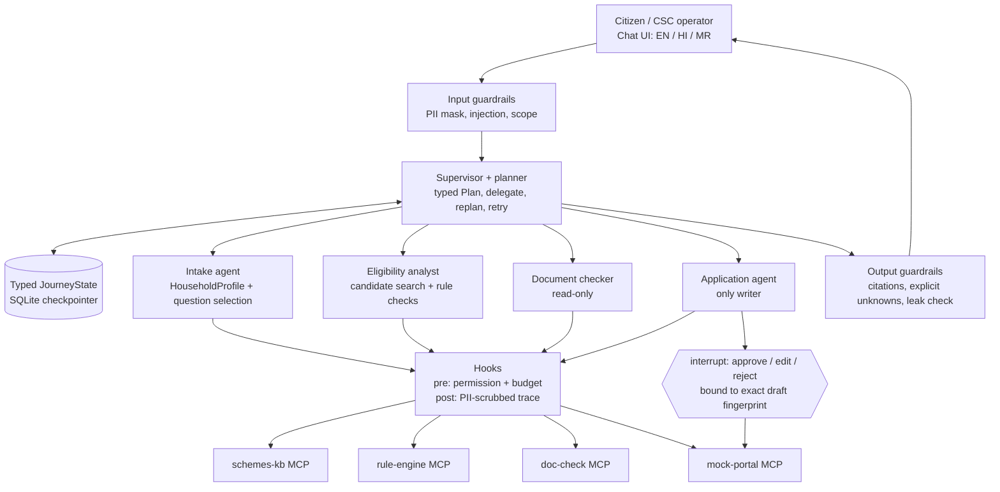

# Scheme Saathi: end-to-end implementation plan (redesign)

> **This is a proposal for the team to discuss.** It is not an approved policy,
> a final design, or a list of assigned people. Agree the schemes, policy,
> owners, and dates together before building against it.

## The idea in one sentence

A person describes their household in their own words; a **supervisor/planner**
shows a plan, delegates to specialist agents that ask only verdict-changing
questions, check every candidate scheme with a deterministic rule engine, list
documents, and draft a **mock** application that is submitted only after the
person approves the exact form. AI never decides eligibility, and nothing is
sent to a real government service.

## Why this plan was rewritten

The first vertical slice works and is deployed, but a review against the
capstone brief (`capstone_projects` PDF, pp. 2–3 and 7–8) found that the
LangGraph flow and UI deviate from the required architecture. The UI drives
the journey; the graph only executes one step at a time.

| Brief requirement | First slice (current code) |
|---|---|
| Supervisor **makes a plan and assigns parts of it** to specialists; shows the plan object; **replans when a tool result contradicts it**; handles retries (p. 2, L8, L10). | `orchestrator_agent` returns a fixed sentence chosen by `action`. No plan object, delegation, replanning, retries, or self-correction loop. |
| Plan for Scheme Saathi: **profile → candidate schemes → rules → documents → draft** (p. 7, step 2). | Only search or one-scheme evaluate, chosen by UI buttons. |
| **Intake** creates a typed household profile from the message and **asks only the question that resolves the most open verdicts**; stops when verdicts settle or the user does not know (p. 7, step 3; p. 8 "question-selection loop"). | Intake is a one-shot validator. The UI posts a complete fixture profile, so intake never asks anything. |
| **Eligibility analyst** searches the index filtered by state/gender/age band and sends **each candidate** to the rule engine (p. 7, step 4). | The user picks one scheme from a dropdown; only that scheme is evaluated. |
| **Document checker** and **application agent**; only the application agent has write access to the mock portal (p. 8, L11). | Neither exists. Drafting, fingerprinting, and approval live in Streamlit session state. |
| Every world-changing action goes through **`interrupt()`** with approve/edit/reject bound to the exact payload (L14). | No `interrupt()`; approval is a UI-side fingerprint check; no backend mock portal. |
| Specialists use **ReAct over their own tools** with **typed hand-off messages** (L11). | No ReAct loops or hand-off messages. |
| Hindi/Marathi/English **chat UI** for citizen/CSC operator; input/output guardrails; pre-tool permission/budget and post-tool logging hooks (pp. 2, 7). | Form-driven UI; the Citizen/CSC selector is never read; no guardrails or tool hooks. |

PM-KISAN was added as a direct UI → `POST /api/v1/schemes/PM-KISAN-IN/evaluate`
call. That keeps it consistent with the widow-pension screen sequence, but it
bypasses the graph entirely and must be migrated (Phase 3).

## What we have now (keep and reuse)

- FastAPI backend and a shared stdio MCP server with separate tool modules for
  deterministic eligibility and hybrid scheme search.
- Hybrid retrieval: BM25 + multilingual Qdrant vectors (OpenRouter
  `voyageai/voyage-4`), query decomposition, RRF, hosted Cohere rerank with a
  0.3 cutoff (the best passage is kept at 0.2 or above if none reach 0.3),
  top 5 passages; 43-query development evaluation set.
- Reviewed, versioned rule package for IGNWPS-MH; a separately typed,
  synthetic-only PM-KISAN package based on guidelines revised 2020-03-29
  (current landholding cutoff and State/UT records unverified).
- LangGraph with typed state and an SQLite checkpointer; forget-session API.
- Draft fingerprinting logic (`src/ui/approval.py`) that can move to the
  backend approval gate.
- Azure deployment of separate API and UI container apps.

## Target architecture



### Agents and their tools (least privilege)

| Agent | Responsibility | Tools it may call | Must not |
|---|---|---|---|
| **Supervisor/planner** | Build and show the `Plan`; delegate each step via a typed hand-off; mark steps done/blocked; replan on contradiction; bounded retries; decide when to pause for the user. | None directly (routes to specialists). | Decide eligibility; call write tools. |
| **Intake** | Extract a typed `HouseholdProfile` from free text; pick the single question that resolves the most open verdicts; stop when verdicts settle or the user says they don't know. | `rule-engine.required_facts`, `rule-engine.evaluate` (dry-run to score questions). | Ask for Aadhaar/bank numbers; treat unknown as "no". |
| **Eligibility analyst** | Search candidate schemes filtered by state/gender/age band; evaluate **each** candidate; return verdict, deciding clause, missing fields. | `schemes-kb.search_schemes`, `schemes-kb.get_scheme`, `rule-engine.evaluate`. | Override or reinterpret rule-engine verdicts. |
| **Document checker** | List required documents for eligible schemes; compare with what the household reports; flag mismatches and explain correction. | `schemes-kb.get_documents`, `doc-check.check_documents`. | Invent unverified document lists; assert authenticity. |
| **Application agent** | Create a mock draft for an eligible scheme; pause for approval; submit only the approved fingerprint; report status. | `mock-portal.create_draft/get_draft/submit_draft/get_status`. | Submit without an approval token bound to the unchanged draft. |

LLMs are used for understanding text, extracting candidate profile facts,
phrasing questions/explanations, and planning within an allowed step
vocabulary. **Verdicts, question scoring, and approval checks are code.**

### Typed state (sketch for team agreement)

```python
class PlanStep(BaseModel):
    step_id: Literal["profile", "candidates", "rules", "documents", "draft"]
    owner: Literal["intake", "eligibility", "documents", "application"]
    status: Literal["pending", "in_progress", "done", "blocked", "skipped"]
    reason: str | None = None

class Plan(BaseModel):
    version: int                  # increments on every replan
    steps: list[PlanStep]
    replan_reason: str | None = None

class HouseholdProfile(BaseModel):  # every fact optional; None = unknown
    state: str | None = None
    applicant_gender: str | None = None
    date_of_birth: date | None = None
    is_widow: bool | None = None
    bpl_card_shown: bool | None = None
    landholding_family_in_state_records: bool | None = None
    # ... PM-KISAN exclusions and future scheme facts
    declined_fields: set[str] = set()   # "I don't know" stops re-asking

class CandidateVerdict(BaseModel):
    scheme_id: str
    result: Literal["eligible", "not_eligible", "need_more_information"]
    deciding_rule_ids: list[str]
    missing_fields: list[str]
    evidence: list[RuleEvidence]

class Handoff(BaseModel):          # supervisor -> specialist and back
    step_id: str
    task: str
    inputs: dict[str, Any]
    outcome: Literal["completed", "needs_user", "failed", "contradiction"] | None = None
    summary: str | None = None

class JourneyState(TypedDict, total=False):
    conversation_id: str
    locale: Literal["en", "hi", "mr"]
    mode: Literal["citizen", "csc"]
    messages: Annotated[list[Message], add]
    plan: Plan
    profile: HouseholdProfile
    candidates: list[CandidateVerdict]
    pending_question: Question | None
    documents: list[DocumentFinding]
    draft: MockDraft | None
    approval: ApprovalDecision | None
    handoffs: Annotated[list[Handoff], add]
    retries: dict[str, int]
    budget: Budget
```

### Graph shape

```text
START -> input_guardrails -> supervisor
supervisor --(next step owner)--> intake | eligibility | documents | application
intake      -> supervisor   (profile updated; or pending_question -> END turn)
eligibility -> supervisor   (verdicts; contradiction -> replan)
documents   -> supervisor
application -> approval_gate (interrupt) -> application (submit) -> supervisor
supervisor --(plan complete or awaiting user)--> output_guardrails -> END
```

- **Self-correction loop:** eligibility → supervisor → intake → eligibility
  repeats while open verdicts can be resolved by an answerable question.
- **Pause and resume:** a question or approval ends the turn with state
  checkpointed; the next user message (or approval decision) resumes the
  same `conversation_id`. A crash mid-application resumes from the last
  checkpoint (p. 8).
- **Retries:** transient MCP failures retry with a bounded count per step;
  after the limit the step is `blocked` and the user sees the failure. No
  fixture verdict ever substitutes for a failed tool.

### Replan triggers (each must appear in a trace)

| Trigger | Replan |
|---|---|
| No candidate scheme matches the profile | Mark `rules/documents/draft` skipped; explain and suggest related information-only schemes. |
| All candidates `not_eligible` | Skip documents/draft; explain deciding clauses. |
| A new answer contradicts an earlier fact (e.g., age changes) | Re-open `profile`/`rules`; invalidate any draft approval. |
| Document mismatch found | Insert a "resolve mismatch" step before `draft`. |
| User asks to submit while a verdict is `need_more_information` | Refuse submit; route back to intake or to human caseworker referral (L14). |
| Tool repeatedly fails | Mark step `blocked`; offer retry later. |

### Intake question-selection loop (code, not LLM)

1. Ask the rule engine for each candidate's `required_facts` and current verdict.
2. For every unknown, not-declined field, count how many open
   (`need_more_information`) verdicts it could change.
3. Ask the highest-scoring field first (ties: rule-package order). The LLM only
   phrases the question in the user's language.
4. Stop when no open verdict depends on an answerable unknown, or the user
   answers "don't know" (record in `declined_fields`; the verdict stays
   "can't tell" and is referred to a human caseworker).

Evaluation must compare this **planned question order** with a fixed order
(p. 8 ablation): questions per conversation and accuracy.

### Rule engine generalisation

- Move to one rule-package schema that supports both IGNWPS-MH and PM-KISAN
  (field definitions, operators, question metadata, source evidence,
  `approval_scope`), validated at startup by `RulePackageProvider`.
- Add `rule-engine.required_facts(scheme_id)`; `rule-engine.evaluate` accepts
  a partial `HouseholdProfile` and returns all three verdict states.
- Retire the PM-KISAN direct endpoint once its package runs through the MCP
  rule engine; keep its 2020-baseline/currentness notice on every result.

### UI redesign

- Chat-first screen in English, Hindi, and Marathi; the citizen/CSC mode is
  passed to the backend (CSC mode may show the profile and plan in more detail).
- Always-visible synthetic-demo warning and the supervisor's **plan panel**
  (step status and plan version; highlight replans).
- Intake questions are rendered as chat turns with quick answers
  (Yes / No / Don't know) where the field is boolean.
- Verdict cards per candidate scheme with deciding clause, source, and missing
  facts; document findings; the mock draft with Edit / Approve / Reject that
  calls the backend approval endpoint.
- The UI holds no journey logic or approval state; everything comes from the
  API. Fixture scenarios remain only as "fill with example" shortcuts for demos.

### API contract (to agree before building)

| Endpoint | Purpose |
|---|---|
| `POST /api/v1/journey/{conversation_id}/messages` | Send a user message; returns plan, messages, pending question, candidates, documents, draft (streaming optional). |
| `POST /api/v1/journey/{conversation_id}/approval` | `approve` / `edit` / `reject` bound to the draft fingerprint; resumes the interrupted graph. |
| `GET /api/v1/journey/{conversation_id}` | Current state for resume after reload/crash. |
| `DELETE /api/v1/journey/{conversation_id}` | Forget the session (existing). |

The existing `/api/v1/journey` (`search`/`evaluate`) stays until the UI moves
over, then is removed.

## MCP tool boundaries

One `saathi_mcp_server` process may host several tool groups locally, but
permissions are enforced per agent by hooks.

| MCP service | Tools | Access |
|---|---|---|
| `rule-engine` | `evaluate(profile, scheme_id)`, `required_facts(scheme_id)` | Read-only, deterministic. Returns verdict, reason, missing fields, rule IDs, and evidence. No LLM. |
| `schemes-kb` | `search_schemes(query, filters, locale)`, `get_scheme(scheme_id)`, `get_documents(scheme_id)` | Read-only, source-linked. Do not claim unverified document requirements. |
| `doc-check` | `check_documents(scheme_id, supplied_document_metadata)` | Read-only, synthetic-only. Reports missing items and mismatches; no authenticity claims. |
| `mock-portal` | `create_draft`, `get_draft`, `submit_draft`, `get_status` | Application agent only. `submit_draft` requires an approval token bound to the exact fingerprint. ID numbers are sent only here. Never a real portal. |

## Guardrails, hooks, and observability

- **Input guardrails:** mask Aadhaar/bank-like numbers before any LLM or
  trace; detect prompt injection, including injection inside scheme text;
  enforce scope; refuse requests to misstate income or age.
- **Pre-tool hooks:** per-agent tool allow-list and per-conversation
  call/token budget. **Post-tool hooks:** PII-scrubbed trace of every LLM and
  tool call.
- **Output guardrails:** every verdict cites its clause; unknowns are explicit;
  no PII leakage; readable output in the selected language.
- Operational logs to stdout/stderr; no applicant data, secrets, or raw
  document contents in logs.
- Metrics (later phase): questions per conversation, can't-tell rate, waiting
  approvals, masked-ID hits, cost per conversation; alert on can't-tell spikes.

## Build in this order

Each phase must pass its gate before the next builds on it.

The working build order, with UI built alongside each phase and a UI test
checklist per phase, is in
[PHASE_WISE_IMPLEMENTATION_PLAN.md](PHASE_WISE_IMPLEMENTATION_PLAN.md). The
phases below describe the architecture scope by role.

### Phase 0 — Agree contracts (Roles 1, 3, 4, 5)

Agree the typed `Plan`, `HouseholdProfile`, `Handoff`, `CandidateVerdict`, the
generic rule-package schema, and the API contract above.
**Gate:** reviewed examples for each type; Role 1 confirms profile fields map to
reviewed rules.

### Phase 1 — Generic rule engine (Roles 4, 1, 5)

One package schema for IGNWPS-MH and PM-KISAN; `required_facts`; partial-profile
evaluation through MCP.
**Gate:** existing widow-pension tests and PM-KISAN tests pass through the MCP
rule engine with identical verdicts.

### Phase 2 — Supervisor, plan, and intake loop (Role 3, with 4 and 5)

Supervisor builds/updates the `Plan`, delegates via `Handoff`; intake extracts
profile facts from text and runs the question-selection loop; pause/resume
across turns via the checkpointer.
**Gate:** from "My 62-year-old widowed mother in Pune has a BPL card", the graph
shows a plan, asks only missing verdict-changing questions, and resumes after a
restart.

### Phase 3 — Eligibility analyst over all candidates (Roles 3, 2)

Filtered candidate search; evaluate every candidate; replan triggers; migrate
PM-KISAN off its direct endpoint.
**Gate:** one conversation yields verdicts for both pilot schemes, and a trace
shows at least one replan.

### Phase 4 — Chat UI (Role 6, with 3)

Chat-first UI with plan panel, question turns, verdict cards, and mode/locale
passed to the backend; remove UI-side journey logic.
**Gate:** a teammate completes the journey locally in all three languages
without Azure access.

### Phase 5 — Documents, application agent, and approval interrupt (Roles 4, 3, 5)

`doc-check` and `mock-portal` MCP tools; document checker; application agent
with `interrupt()` approve/edit/reject; fingerprint check moved to the backend.
**Gate:** an edit invalidates approval; only the unchanged approved draft is
submitted; repeated or unapproved submits are rejected; crash mid-application
resumes.

### Phase 6 — Guardrails, hooks, memory, and evaluation (Roles 4, 5, 2, 6)

Input/output guardrails; permission/budget hooks; PII-scrubbed traces;
consent-based household memory with pseudonymous ID, expiry, and delete;
60 synthetic personas double-labelled; simulated citizen; single-agent
baseline; planned-vs-fixed question order; 30+ red-team attacks.
**Gate:** evaluation harness runs in CI with a threshold; attack success and
false-block rates reported with defences off/on.

### Phase 7 — Operations and deployment (Role 6)

Docker Compose with app, MCP servers, vector store, Prometheus, and Grafana;
dashboard and one working alert; Azure deployment via the existing workflow.
**Gate:** clean-machine install and a documented failed CI run.

## How the six roles contribute

The repository does not name role owners yet; fill these in together.

| Role | Main ownership in this plan |
|---|---|
| **1. Domain and product** | Rule meaning, profile fields, persona expected outcomes, held-out checks against written policy. |
| **2. Knowledge and memory** | Scheme corpus, filtered candidate search, documents data, consent-based household memory. |
| **3. Agents and orchestration** | Supervisor/planner, hand-offs, intake loop, replanning, interrupts, resume. |
| **4. Tools, control and security** | Generic rule engine, MCP services, hooks, approval binding, guardrails. |
| **5. Evaluation and red-team** | Personas, simulated citizen, ablations, attacks; never writes held-out cases they tune against. |
| **6. Deployment and operations** | Chat UI wiring, CI evaluation gate, Docker Compose, dashboards, Azure. |

## Completion gates (whole system)

- The supervisor shows a typed plan, delegates via typed hand-offs, and a trace
  shows a replan.
- Intake asks only verdict-changing questions and stops correctly on "don't know".
- Every candidate verdict comes unchanged from the deterministic rule engine,
  with clause and source.
- Only the application agent can write to the mock portal, and only with an
  approval bound to the unchanged draft via `interrupt()`.
- Conversations resume after a restart, including mid-application.
- No real personal data is stored, logged, or submitted.

## Team decisions still needed

1. Do we accept this redesign and phase order?
2. Who owns each role and backup?
3. Which LLM models are used for the supervisor (stronger) and specialists?
4. What is the exact `HouseholdProfile` field list for the pilot schemes?
5. Should PM-KISAN stay on its 2020 mock baseline until policy currentness is verified?
6. What must be in the next demo, and what can wait?

## Final demo checklist

- [ ] The user sees the synthetic-demo warning and the plan.
- [ ] A free-text household description becomes a typed profile.
- [ ] Only verdict-changing questions are asked; "don't know" is respected.
- [ ] All candidate schemes are checked by the plain-code rule engine.
- [ ] Each verdict shows its deciding clause and source.
- [ ] A replan is visible when a result contradicts the plan.
- [ ] Documents are listed only when verified; mismatches are explained.
- [ ] Editing the draft clears approval; only the approved draft reaches the mock portal.
- [ ] The conversation resumes after a restart.
- [ ] The same case gives the same verdict in English, Hindi, and Marathi.
- [ ] "Forget my data" removes the session.
