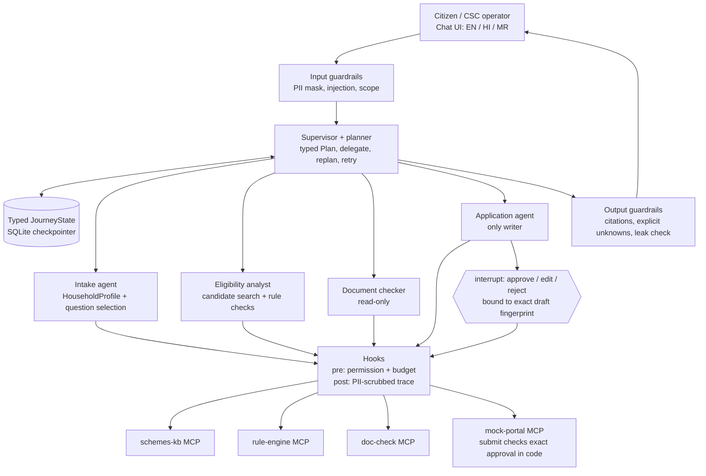

# Scheme Saathi: end-to-end implementation plan (redesign)

> **Reconciled against the source PDF on 2026-11-03.** This is the target
> architecture, not a claim that every box is implemented or accepted.
> The existing rule engine, tools, graph, UI and approval storage are reused.
> Team owners, model budgets, policy sign-offs and acceptance dates still need
> agreement. No application code is changed by this planning revision.

## Which document controls what?

| Document | Purpose |
|---|---|
| Original capstone PDF, pp. 2–3, 5–8 | Architecture, minimum requirements and experiments; separate cohort guidelines control marking and deadlines. |
| [Guide reference](CAPSTONE_PROJECT_GUIDE_REFERENCE.md) | Page-referenced source notes; not evidence of implementation. |
| This document | Target architecture and cross-phase invariants. |
| [Phase-wise plan](PHASE_WISE_IMPLEMENTATION_PLAN.md) | **The single six-phase implementation order**, repair batches, gaps and acceptance gates. |
| [Catalogue plan](SCHEME_CATALOGUE_AND_DELIVERY_PLAN.md) | Parallel source/gold-policy/data workstream, not a second application phase order. |
| [Retrieval backlog](RETRIEVAL_IMPROVEMENT_BACKLOG.md) | Retrieval experiments; historical metrics are not current full-pipeline acceptance. |
| Phase 1–4 walkthroughs; [frontend prototype contract](FRONTEND_CONTRACT.md) | Descriptions of particular implementation slices, not capstone completion certificates. |

The local roles/work-plan PDF is a team guide, not another application phase
numbering scheme. Its approval-expiry/one-use requirements are retained below.
Rule-review documents are source-evidence records, not schedule documents; this
review does not change policy packages, review statuses or held-out data.

## The idea in one sentence

A person describes their household in their own words; a **supervisor/planner**
shows a plan, delegates to specialist agents that ask only verdict-changing
questions, check every candidate scheme with a deterministic rule engine, list
documents, and draft a **mock** application that is submitted only after the
person approves the exact form. AI never decides eligibility, and nothing is
sent to a real government service.

## Actual baseline and the remaining mismatch

**2026-11-04 planning update:** the current local implementation has bounded
specialists, enforced permissions, persistent budgets, shared file-backed
demo checklists and exact expiring approval. The latest offline suite passed
361 tests, including two integrated UI flows. These changes are local;
`770bc5c` below describes the earlier shared deployment, not this worktree.
The **typed fact registry and versioned bundle foundation** is now implemented
in the shared evaluator, with a legacy pilot adapter and strict startup pins.
The latest builder full offline run passed 375 tests. Independent code review
and a separate-model walkthrough review passed after corrections. Dynamic
intake/questions, generic conditions/forms and approved new-bundle publication
remain later work; fact/question/privacy review metadata is pending.

Commit `770bc5c` contains the Phase 1–4 implementation and was validated and
deployed to both shared apps by
[workflow run 41638806677](https://github.com/Roy-developer/scheme-saathi-capstone/actions/runs/41638806677).
Deployment success does not sign off the manual UI gates or the PDF's minimum bar.

| Area | Keep | Still required |
|---|---|---|
| Rules and retrieval | Two pilot packages, registry-validated deterministic MCP evaluator, pinned bundle loading and retrieval | Reviewed registry metadata, approved novel-bundle activation, corpus/gold expansion and retrieval evidence |
| Orchestration | Bounded specialist loops, confirmed intake, shared interviews, rediscovery, durable budgets | Data-defined questions, typed answers and meaning-aware sharing; manual/live acceptance |
| MCP | Four services, enforced actor/action permissions and private portal | Registry/bundle version-consistent contracts; preserve least privilege |
| Documents | Shared file-backed demo lists, synthetic name/date comparison, referral and coordinated publication | Registry-aware conditions; real source preparation and human checklist approval |
| Applications | Exact revision approval, expiry/one-use receipts, invalidation and retry recovery | Generic reviewed form mappings and bundle-bound approval; operational acceptance |
| UI | Citizen/CSC controls, localized text and two integrated automated flows | Generic typed widgets and human visual/language acceptance |
| Capstone evidence | 361 offline tests and historical deployment checks | Data-only onboarding proof, memory, extractor/Reflexion, E1–E4 and full operations |

Keep the deterministic C0 baseline and bounded specialist implementation.
Neither establishes that an arbitrary scheme can be added from passages alone.
The new gates extend the common data layer without replacing working services.

## What we have now (keep and reuse)

- FastAPI backend, four purpose-specific stdio MCP services, and a separate
  local FastAPI mock-portal service with its own SQLite database. See the
  [Phase 1 tool inventory](MCP_TOOL_INVENTORY.md).
- Hybrid retrieval: BM25 + multilingual Qdrant vectors (OpenRouter
  `voyageai/voyage-4`), query decomposition, RRF, hosted Cohere rerank with a
  0.3 cutoff (the best passage is kept at 0.2 or above if none reach 0.3),
  configurable result limits; journey discovery requests up to 20 passages.
  The 43-query development set and historical Recall@5 results are not
  current full-pipeline acceptance.
- Two versioned pilot rule packages: IGNWPS-MH and synthetic-only PM-KISAN,
  the latter based on guidelines revised 2020-03-29
  (current landholding cutoff and State/UT records unverified).
- LangGraph with typed state and an SQLite checkpointer; forget-session API.
- Backend draft fingerprinting and per-revision approval graph; the earlier
  UI approval helper remains a historical implementation detail.
- Azure deployment of separate API and UI container apps.

## Target architecture



### Agents and their tools (least privilege)

| Agent | Responsibility | Tools it may call | Must not |
|---|---|---|---|
| **Supervisor/planner** | Build and show the `Plan`; delegate each step via a typed hand-off; mark steps done/blocked; replan on contradiction; bounded retries; decide when to pause for the user. | None directly (routes to specialists). | Decide eligibility; call write tools. |
| **Intake** | Extract a typed `HouseholdProfile` from free text; pick the single question that resolves the most open verdicts; stop when verdicts settle or the user says they don't know. | `rule-engine.required_facts`, `rule-engine.evaluate` (dry-run to score questions). | Ask for Aadhaar/bank numbers; treat unknown as "no". |
| **Eligibility analyst** | Search with existing supported filters and confirmed hints; evaluate **each** supported candidate; keep others information-only. Return verdict, deciding clause and missing facts. | `schemes-kb.search_schemes`, `schemes-kb.get_scheme`, `rule-engine.evaluate`. | Override engine verdicts or invent state/gender/age filters that retrieval does not support. |
| **Document checker** | List required documents for eligible schemes; compare with what the household reports; flag mismatches and explain correction. | `schemes-kb.get_documents`, `doc-check.check_documents`. | Invent unverified document lists; assert authenticity. |
| **Application agent** | Create a mock draft for an eligible scheme; pause for approval; submit only the approved fingerprint; report status. | `mock-portal.create_draft/get_draft/submit_draft/get_status`. | Submit without an approval token bound to the unchanged draft. |

LLMs are used for understanding text, extracting candidate profile facts,
phrasing questions/explanations, and planning within an allowed step
vocabulary. **Verdicts, question scoring, and approval checks are code.**

### What qualifies as a specialist here?

The source PDF explicitly says specialists use ReAct (pp. 2–3): a model proposes
an allowed next action, code authorizes it, a tool returns an observation, and
the specialist either chooses another permitted action or returns a typed
handoff. A single fixed LLM rewrite or answer-parsing call is not that loop.

Use the four named specialists in the Scheme Saathi brief:

| Specialist | Meaningful model choices | Code keeps control of |
|---|---|---|
| Intake | Propose profile facts from the initial description; clarify an unclear reply; explain the next question | Field/type/scope validation, confirmation, deterministic question scoring and unknown handling |
| Eligibility analyst | Choose a bounded search/refinement or evidence lookup; request missing rule evidence | Candidate limit, supported filters, official-source policy and every eligibility verdict |
| Document checker | Request a source-linked checklist, inspect synthetic extracted fields, explain a flagged discrepancy or recommend referral | Deterministic field comparison, requirement provenance and draft blocking |
| Application | Propose safe draft preparation/update or status lookup from the permitted actions | Current eligibility, dependency versions, actual portal writes and exact human approval |

Use a model-proposed, schema-constrained supervisor plan with code validation
of dependencies and transitions; do not make deterministic question scoring
or rule outcomes model decisions. Keep existing pure planner functions as
validators/fallbacks and as the C0 comparison. Rejected/over-budget proposals
stop safely or use an explicitly labelled fixed-workflow fallback.

Before enabling these loops, enforce tool/action permissions, input masking,
untrusted-data boundaries, per-step iteration limits and conversation-wide
call/token/spend ceilings. Record model IDs, prompts (role/context/task/
constraints/format/examples), limits and sampling in versioned config.
Persist consumed budgets across correction, refresh, request restart and
process restart; reject further paid actions at the ceiling. Agree numeric
ceilings before live calls; do not silently invent new paid usage.

Trace observable action names, sanitized inputs/results, short decision
summaries, timing and usage. Do not request or store private chain-of-thought.
Keep the existing once-per-fact answer-interpretation counter separate from
the new agent-loop and search budgets. New agent loops need their own bounded,
measurable policy; they must not secretly reset the older counter.

### Earlier typed state sketch (not the new registry contract)

This sketch records the earlier design, not exact current models. In
particular, state/gender are not current confirmed fields. The implemented
`HouseholdProfile` (`src/rules/facts.py`) is registry-backed instead of a fixed
list of fields, and handoffs are typed. Use it and the versioned contracts
specified under "Rule engine generalisation"; agree their migration before
implementation rather than adding a Python field for every new scheme.

```python
class PlanStep(BaseModel):
    step_id: Literal["profile", "candidates", "rules", "documents", "draft"]
    owner: Literal["intake", "eligibility", "documents", "application"]
    status: Literal["pending", "in_progress", "done", "blocked", "skipped"]
    reason: str | None = None

class Plan(BaseModel):
    version: int                  # increments on every replan
    steps: list[PlanStep]
    replan_reason: str | None = None

class HouseholdProfile(BaseModel):  # every fact optional; None = unknown
    state: str | None = None
    applicant_gender: str | None = None
    date_of_birth: date | None = None
    is_widow: bool | None = None
    bpl_card_shown: bool | None = None
    landholding_family_in_state_records: bool | None = None
    # ... PM-KISAN exclusions and future scheme facts
    declined_fields: set[str] = set()   # "I don't know" stops re-asking

class CandidateVerdict(BaseModel):
    scheme_id: str
    result: Literal["eligible", "not_eligible", "need_more_information"]
    deciding_rule_ids: list[str]
    missing_fields: list[str]
    evidence: list[RuleEvidence]

class Handoff(BaseModel):          # supervisor -> specialist and back
    step_id: str
    task: str
    inputs: dict[str, Any]
    outcome: Literal["completed", "needs_user", "failed", "contradiction"] | None = None
    summary: str | None = None

class JourneyState(TypedDict, total=False):
    conversation_id: str
    locale: Literal["en", "hi", "mr"]
    mode: Literal["citizen", "csc"]
    messages: Annotated[list[Message], add]
    plan: Plan
    profile: HouseholdProfile
    candidates: list[CandidateVerdict]
    pending_question: Question | None
    documents: list[DocumentFinding]
    draft: MockDraft | None
    approval: ApprovalDecision | None
    handoffs: Annotated[list[Handoff], add]
    retries: dict[str, int]
    budget: Budget
```

### Graph shape

```text
START -> input_guardrails -> supervisor
supervisor --(next step owner)--> intake | eligibility | documents | application
intake      -> supervisor   (profile updated; or pending_question -> END turn)
eligibility -> supervisor   (verdicts; contradiction -> replan)
documents   -> supervisor
application -> approval_gate (interrupt) -> application (submit) -> supervisor
supervisor --(plan complete or awaiting user)--> output_guardrails -> END
```

- **Self-correction loop:** eligibility → supervisor → intake → eligibility
  repeats while open verdicts can be resolved by an answerable question.
- **Pause and resume:** a question or approval ends the turn with state
  checkpointed; the next user message (or approval decision) resumes the
  same `conversation_id`. A crash mid-application resumes from the last
  checkpoint (p. 8).
- **Retries:** transient MCP failures retry with a bounded count per step;
  after the limit the step is `blocked` and the user sees the failure. No
  fixture verdict ever substitutes for a failed tool.

### Replan triggers (each must appear in a trace)

| Trigger | Replan |
|---|---|
| No candidate scheme matches the profile | Mark `rules/documents/draft` skipped; explain and suggest related information-only schemes. |
| All candidates `not_eligible` | Skip documents/draft; explain deciding clauses. |
| A new answer contradicts an earlier fact (e.g., age changes) | Re-open `profile`/`rules`; invalidate any draft approval. |
| Document mismatch found | Insert a "resolve mismatch" step before `draft`. |
| User asks to submit while a verdict is `need_more_information` | Refuse submit; route back to intake or to human caseworker referral (L14). |
| Tool repeatedly fails | Mark step `blocked`; offer retry later. |

### One invalidation rule across phases

Approval means "this exact draft, based on these current facts, documents and
rules", not merely "the JSON digest once matched".

The repair design binds each draft/approval to monotonic profile and document
versions, rule-package version/hash and a draft revision/fingerprint. A relevant
change marks affected unsubmitted drafts stale and **clears their persisted
approval**, even if eligibility remains `eligible`. Changing a value back never
restores an earlier authorization. Use a conservative invalidate-all-unsubmitted-
drafts policy within the conversation until per-scheme dependencies are proven.

The application specialist performs portal invalidation as trusted code, not
an optional LLM suggestion. If the portal cannot record invalidation, block
approval/submission until reconciliation succeeds; retain the invalidation
intent for retry. Check dependencies again at the actual submit boundary, with
concurrent correction/submit behavior defined so a stale draft cannot slip
between a precheck and write. Keep submitted receipts as history; do not pretend
that changing an answer reverses an earlier mock submission.

Changing document reports or rule packages also invalidates affected approvals.
Unknown eligibility, information-only, tool failure, stale dependencies,
unverified requirements and unresolved document conflicts cannot authorize
drafting/submission. Let the person decline/correct a draft without regaining
eligibility; show a safe referral path, not an invented verdict.

**Phase 3 implementation (2026-11-04):** portal transactions now maintain
monotonic profile/document/rule dependencies and persistent stale flags,
preserving submitted receipts. Profile correction first checkpoints its
invalidation intent and always attempts portal revocation, even if that
checkpoint fails. A portal failure leaves the intended next profile version
in the checkpoint; a checkpoint failure leaves the portal blocked. Successful
recheck checkpoints precede portal reconciliation. Writes verify the expected
profile version; the portal serializes mutation/invalidation with SQLite
`BEGIN IMMEDIATE`. Same-process conversation mutations are also serialized.
An interrupted transition stays closed pending trusted reconciliation; do not
clear that state merely to permit submission.

The eligibility specialist selects a checked verdict handoff, observed-missing-
facts clarification, or unavailable-tool referral under its own action
allowlist. Only the engine supplies verdicts. Confirmed category/age search
hints and explicit locale are supported today; absent state/gender fields and
unsupported retrieval filters are not inferred. Search has four conversation
attempts including retries and an explicit 20-ID processing limit with overflow
reporting. Durable records (the LangGraph `Store` since branch
`supervisor-redesign-3`) reserve search/model/token/step/action work and
interpretation attempts before dispatch, including failed nodes.
These repairs have offline automated coverage, not manual or live acceptance.

The local roles guide additionally specifies approval expiry and one use.
Agree the expiry interval explicitly. Atomically consume submission authority
with the portal write; an identical retry returns the saved receipt without
executing another submission. This is different from allowing token replay
against another draft or revision. Reconcile checkpoint/portal failures and
test crash recovery; the two stores are not one transaction today.

### Intake question-selection loop (code, not LLM)

1. Ask the rule engine for each candidate's `required_facts` and current verdict.
2. For every unknown, not-declined field, count how many open
   (`need_more_information`) verdicts it could change.
3. Ask the highest-scoring field first (ties: rule-package order). The LLM only
   phrases the question in the user's language.
4. Stop when no open verdict depends on an answerable unknown, or the user
   answers "don't know" (record in `declined_fields`; the verdict stays
   "can't tell" and is referred to a human caseworker).

Evaluation must compare this **planned question order** with a fixed order
(p. 8 ablation): questions per conversation and accuracy.

### Rule engine generalisation

**Phase 1 foundation (automated local checks, 2026-11-04):** the deterministic
evaluator now accepts registry-validated typed facts through the MCP core;
the pilot rule files remain unchanged behind explicit legacy mappings, and
versioned bundle manifests pin the rule and fact-registry contents. A temporary
synthetic numeric/finite-choice bundle proves data-only evaluation. Existing
pilot policy is not re-approved by this code change, and registry fact,
question, and privacy review metadata remains pending. Registry-driven
questions/corrections, checklist and form integration, and coordinated
publication remain future work.

Scheme onboarding is data-only only when every needed type, operator, derived
calculation and form operation is supported. More source passages alone cannot
supply new runtime fact types. Phase 2 now connects registry-defined questions,
strict answer parsing, typed checkpoint facts and version-compatible resumption
to the actual single-scheme journey and deterministic eligibility tool. Its
synthetic number/choice proof remains development-only and requires explicit
test injection; pending privacy policies do not authorize model disclosure.
Cross-scheme sharing/correction and generic document/form mapping remain later
phase work.

Use three small contracts:

1. **Fact registry:** stable IDs, precise meaning, person/family scope, time
   period, units, type, bounds/choices, localized question/help, privacy policy,
   version and review state. Shared facts have one definition; different
   meanings never share an ID just because labels look similar.
2. **Typed fact store:** confirmed values, explicit unknown/declined state and
   provenance/version references, validated by the registry. Never an arbitrary
   unchecked `dict`; no invented fields or silent coercion to false/zero.
3. **Scheme bundle:** exact compatible references to facts, rules, source
   evidence, checklist and mock form mapping, with hashes/currentness/review.
   The loader validates the complete set before exposing that scheme.

Initial supported answers: boolean, date, integer, decimal and finite choice;
bounded text only for approved display/form purposes. Define explicit
type/operator combinations and code-owned derived calculations (age first).
Reject unsupported formulas, cycles, unknown fields, units and incompatible
versions. No executable expressions, Python/SQL, `eval` or LLM-decided policy
in the files. A genuinely new calculation requires code, review and tests.

Questions and corrections use the registry; the evaluator uses the supported
operation set. Both document tools use the same reviewed checklist loader.
Document conditions and mock form fields refer to compatible registered facts.
Missing document evidence stays unverified, not "nothing required".

The bundle version includes its dependent definition/content versions. Package
updates cannot reinterpret existing answers or restore old approvals. Pin a
conversation to compatible definitions, or explicitly migrate/reconfirm its
facts and cancel affected approval. Extend coordinated publication to activate
one complete version; do not hot-load unrelated partial file updates.

Preserve the generic API and current reviewed pilot rule JSON. Plan a reviewed
adapter/migration for existing profile names/checkpoints rather than deleting
saved journeys. A public API/model change needs an explicit contract update
and compatibility tests at implementation time. The 2020 PM-KISAN notice and
synthetic-only authority remain.

**Proof:** after the common runtime changes, add a synthetic scholarship using
a new numeric fact and a choice question by data files alone, with no further
`src/` changes. Complete interview, engine, correction, document and exact
mock-approval flow. Keep the synthetic package out of official/gold counts and
the normal catalogue. Re-run both pilots unchanged.

### UI redesign

- Chat-first screen in English, Hindi, and Marathi; the citizen/CSC mode is
  passed to the backend (CSC mode may show the profile and plan in more detail).
- Always-visible synthetic-demo warning and the supervisor's **plan panel**
  (step status and plan version; highlight replans).
- Intake questions are rendered as chat turns with quick answers
  (Yes / No / Don't know) where the field is boolean.
- Verdict cards per candidate scheme with deciding clause, source, and missing
  facts; document findings; the mock draft with Edit / Approve / Reject that
  calls the backend approval endpoint.
- The UI holds no authoritative journey/approval decisions; cached display
  state must refresh from the API after corrections. Fixture scenarios remain
  only as "fill with example" shortcuts for demos.

### API contract: preserve the baseline, review additions

| Endpoint | Purpose |
|---|---|
| `POST /api/v1/journey/{conversation_id}/messages` | Existing interview reply; returns typed plan/question/verdict state. Drafts have their own routes below; safe streaming is planned for Phase 6. |
| `POST /api/v1/journey/{conversation_id}/corrections` | Existing multi-scheme correction; repair must invalidate dependent drafts/approvals as well as results. |
| `POST /api/v1/journey/{conversation_id}/documents` | Existing metadata assessment; extend only through reviewed synthetic document/provenance contracts. |
| `POST /api/v1/journey/{conversation_id}/drafts` | Existing draft creation. |
| `GET /api/v1/journey/{conversation_id}/drafts` and `GET /drafts/{draft_id}` under the same journey prefix | Existing draft list/read. |
| `PUT /api/v1/journey/{conversation_id}/drafts/{draft_id}` | Existing edit/new revision; invalidate approval. |
| `POST /api/v1/journey/{conversation_id}/drafts/{draft_id}/approval` | Existing approve/reject/submit action bound to revision and fingerprint. |
| `GET /api/v1/journey/{conversation_id}` | Current state for resume after reload/crash. |
| `DELETE /api/v1/journey/{conversation_id}` | Forget the session (existing). |

Keep `POST /api/v1/journey` (`search`/`evaluate`/`interview`) and the generic
scheme-evaluate API compatible. New locale/mode, dependency versions,
approval status, referral and streaming shapes need explicit API review and
matching UI tests. Do not introduce the old proposed journey-level `/approval`
route or remove public routes simply to match this earlier sketch.

## MCP tool boundaries

Four purpose-specific MCP servers are the Scheme Saathi target (source PDF
pp. 7–8); the generic minimum is at least three FastMCP servers (p. 3).
The current single `MCPServer` process is reusable scaffolding, not compliance.
Keep existing tool implementations while adding separate entry points, typed
outputs/structured errors, read/write annotations and isolated clients.
Resolve SDK/FastMCP compatibility explicitly; changing a class name or adding
decorators alone does not establish process or permission isolation.

| MCP service | Tools | Access |
|---|---|---|
| `rule-engine` | `evaluate(profile, scheme_id)`, `required_facts(scheme_id)` | Read-only, deterministic. Returns verdict, reason, missing fields, rule IDs, and evidence. No LLM. |
| `schemes-kb` | `search_schemes(query, filters, locale)`, `get_scheme(scheme_id)`, `get_documents(scheme_id)` | Read-only, source-linked. Do not claim unverified document requirements. |
| `doc-check` | Synthetic field extraction/comparison and `check_documents(scheme_id, supplied_document_metadata)` | Read-only, synthetic-only. Reports missing items and name/date mismatches; no authenticity claims. Final names/contracts require review. |
| `mock-portal` | `create_draft`, `get_draft`, `submit_draft`, `get_status` | Application agent only for writes. `submit_draft` requires an approval token bound to the exact fingerprint. Only clearly fake identifiers in this prototype; never a real portal. |

The current `mock_portal` is one action-based tool over SQLite. Before exposing
it to models, authorize the **action**, not only the tool name: read access
must not permit `approve`, `submit` or `delete_journey`. Human approval is a
trusted UI/API event, never a tool decision the model can invent. The PDF also
specifies a small separate FastAPI mock portal with its own DB; retain the
database logic behind that boundary rather than treating an MCP function as
the finished portal service.

## Guardrails, hooks, and observability

- **Input guardrails:** mask Aadhaar/bank-like numbers before any LLM or
  trace; detect prompt injection, including injection inside scheme text;
  enforce scope; refuse requests to misstate income or age.
- **Pre-tool hooks:** per-agent tool allow-list and per-conversation
  call/token budget. **Post-tool hooks:** PII-scrubbed trace of every LLM and
  tool call.
- **Output guardrails:** every verdict cites its clause; unknowns are explicit;
  no PII leakage; readable output in the selected language.
- Operational logs to stdout/stderr; no applicant data, secrets, or raw
  document contents in logs.
- Metrics (later phase): questions per conversation, can't-tell rate, waiting
  approvals, masked-ID hits, cost per conversation; alert on can't-tell spikes.

## Build order: one six-phase schedule

The older architecture-only Phase 0–7 numbering is retired. Use the six phases
and repair batches in [the phase-wise plan](PHASE_WISE_IMPLEMENTATION_PLAN.md).
UI, hooks and tests accompany each repaired phase; they are not deferred
until an agent already has unrestricted tools.

| Phase | Scope, including corrections | Accountable roles (people unassigned) |
|---|---|---|
| 1. Base | Typed fact registry/store, compatible bundle loader, deterministic operator validation and pilot migration/parity; keep service boundaries | 1, 4, with 3 and 5 |
| 2. Supervisor and intake | Registry-defined questions/validation/confirmation, privacy-aware extraction, typed UI and existing bounded hooks/budgets | 3, 4, with 6 |
| 3. Multi-scheme and replan | Scope/unit/period-aware fact sharing, discovery, generic corrections and version-bound stale cancellation | 2, 3, 4, with 5 |
| 4. Documents and approval | Registry-aware checklist conditions and data-defined mock form mapping; data-only new-scheme UI→receipt proof | 1, 3, 4, with 5 and 6 |
| 5. Guardrails, memory and evaluation | Registry-aware privacy/memory, complete capstone safety, approved extractor/Reflexion outputs and frozen-version E1–E4 | 1–5, with 6 |
| 6. Operations and final evidence | Complete-bundle publication/migration/rollback, installed-data checks and the remaining full-stack operations/demo gates | 6 with all roles |

Independent source curation and protected-case preparation can proceed in
parallel, but cannot be counted as complete without their own evidence.
Repair already-built cross-phase approval defects first; then close the
revised phase gates in order. Phase 5 stays paused until the redesigned
Phases 1–4 are accepted. Record who tested what, on which commit and
whether it was automated, manual, or a paid live-model run.

## How the six roles contribute

The repository does not name role owners yet; fill these in together.

| Role | Main ownership in this plan |
|---|---|
| **1. Domain and product** | Rule meaning, profile fields, persona expected outcomes, held-out checks against written policy. |
| **2. Knowledge and memory** | Scheme corpus, filtered candidate search, documents data, consent-based household memory. |
| **3. Agents and orchestration** | Supervisor/planner, hand-offs, intake loop, replanning, interrupts, resume. |
| **4. Tools, control and security** | Generic rule engine, MCP services, hooks, approval binding, guardrails. |
| **5. Evaluation and red-team** | Personas, simulated citizen, ablations, attacks; never writes held-out cases they tune against. |
| **6. Deployment and operations** | Chat UI wiring, CI evaluation gate, Docker Compose, dashboards, Azure. |

## Completion gates (whole system)

- The supervisor shows a typed plan, delegates via typed hand-offs, and a trace
  shows a replan.
- Four specialists demonstrate bounded model-selected tool actions/observations
  under enforced permissions; a named graph node alone is not sufficient.
- Four Scheme Saathi MCP services and a separate mock portal meet the agreed
  contracts; outputs/errors and per-action read/write boundaries are tested.
- Intake asks only verdict-changing questions and stops correctly on "don't know".
- Every candidate verdict comes unchanged from the deterministic rule engine,
  with clause and source.
- Only the application agent can write to the mock portal, and only with an
  approval bound to the unchanged draft via `interrupt()` for submission.
  Draft preparation is not submission or a substitute for human review.
- Fact/document/rule changes revoke affected approvals permanently; unknowns
  and mismatches block submission, with visible correction/referral.
- Conversations resume after a restart, including mid-application.
- No real personal data is stored, logged, or submitted.
- Both signature challenges, governed memory, E1–E4, traces, dashboard/alert,
  streaming, Compose and CI evaluation evidence meet the PDF minimum bar.

## Team decisions still needed

1. Do we approve the reconciled architecture and six-phase repair order?
2. Who owns each role and backup?
3. Which model IDs, per-step limits and conversation call/token/spend ceilings
   are approved? E1 uses the same model/tools/budget across configurations.
4. Who approves the initial shared fact definitions, supported operations and
   compatible migration of pilot profiles/checkpoints?
5. Should PM-KISAN stay on its 2020 mock baseline until policy currentness is verified?
6. What must be in the next demo, and what can wait?
7. Who reviews EN/HI/MR wording, source-linked requirements and mismatch referrals?
8. What approval expiry, memory expiry/deletion and storage persistence policies
   are approved? These are not established by a working health endpoint.

## Final demo checklist

- [ ] A development-only synthetic scheme with a new numeric fact and choice
      question completes the flow through data additions alone after the
      common runtime change; both unchanged pilots retain their results.
- [ ] The user sees the synthetic-demo warning and the plan.
- [ ] A free-text household description becomes a typed profile.
- [ ] Only verdict-changing questions are asked; "don't know" is respected.
- [ ] All candidate schemes are checked by the plain-code rule engine.
- [ ] Each verdict shows its deciding clause and source.
- [ ] A replan is visible when a result contradicts the plan.
- [ ] Each specialist uses an allowed ReAct loop; denied tools and exhausted
      budgets stop safely.
- [ ] Documents are listed only when verified; mismatches are explained.
- [ ] Editing the draft clears approval; only the approved draft reaches the mock portal.
- [ ] Correcting facts or documents clears approval even if still eligible;
      changing them back cannot revive it; expiry and replay are refused.
- [ ] Unknown eligibility and document conflicts route to clarification/referral.
- [ ] The conversation resumes after a restart.
- [ ] The same case gives the same verdict in English, Hindi, and Marathi.
- [ ] "Forget my data" removes the session.
- [ ] E1–E4, memory comparison, extractor lessons and full-pipeline retrieval
      measurements are available with failures and costs, not just unit tests.
- [ ] Compose starts the full stack; streaming, dashboard, alert and CI threshold
      are demonstrated on the frozen release.
