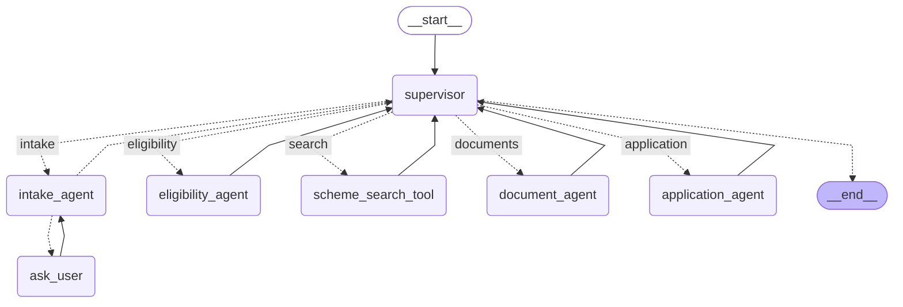

# Journey graph (LangGraph)

Generated by `scripts/export_graph_diagram.py` from the compiled graph in `src/workflow/journey.py`. Do not edit by hand; rerun the script.

## Nodes

- **supervisor**: builds and shows the plan, routes each step, replans when a result contradicts it
- **intake_agent**: asks only questions that can change a verdict; proposals need confirmation
- **ask_user**: interrupt(): pauses for the person's answer (checkpointed, resumable)
- **eligibility_agent**: observes the rule engine's verdict; never writes one
- **scheme_search_tool**: hybrid search over scheme clauses
- **document_agent**: read-only checklist and name/date comparison
- **application_agent**: only node allowed to write drafts; submission needs exact approval

## Where the minimum-bar items live

- Typed state: `src/workflow/state.py`.
- Conditional edges: out of `supervisor` (route to the next step) and `intake_agent` (ask again or continue).
- Persistent checkpointer: SQLite via `AsyncSqliteSaver`; `scripts/demo_resume_after_kill.py` proves resume after a hard kill.
- Human control: `ask_user` and the application approval gate use `interrupt()` / exact-payload approval.
