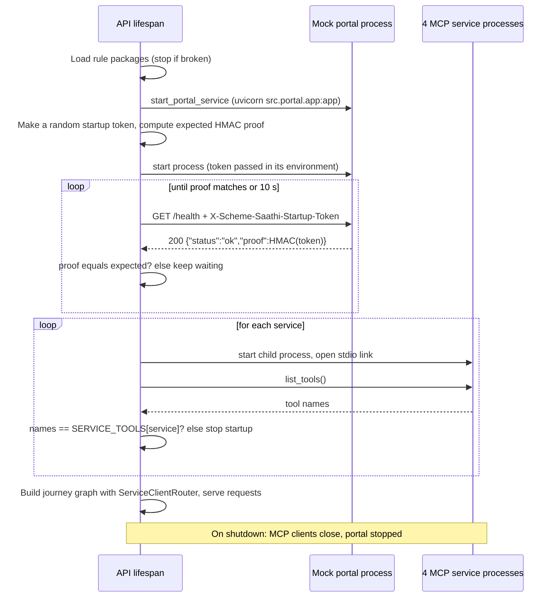
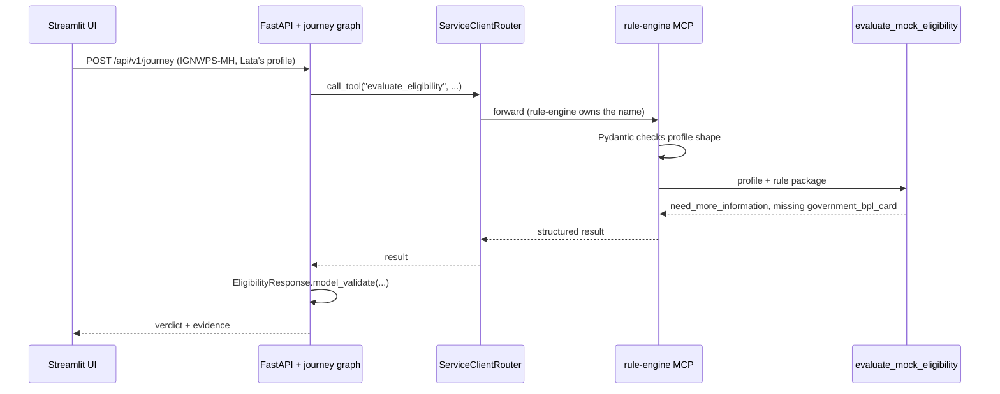
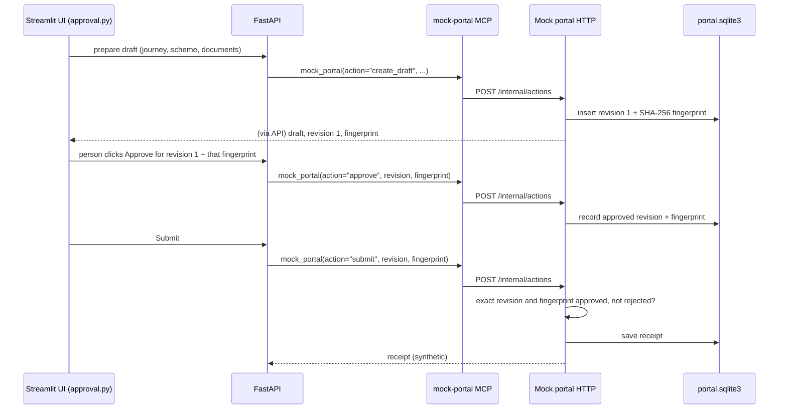

# Phase 1 code walkthrough: one path for every scheme

This guide explains what Phase 1 built, in plain English. It is written for a
new developer who has not seen this code before. It follows one request from
the screen to the rule engine and back. It also lists every edge case Phase 1
handles.

Phase 1 plan: [PHASE_WISE_IMPLEMENTATION_PLAN.md](PHASE_WISE_IMPLEMENTATION_PLAN.md).
Tool list: [MCP_TOOL_INVENTORY.md](MCP_TOOL_INVENTORY.md).

> **Phase 1 has three parts.**
>
> 1. **The common rule engine** (Steps 1–5): one profile, one rule format, one
>    engine, one path for every scheme.
> 2. **The revised foundation gate "G02"** (Step 4B): the single
>    shared MCP server was split into **four separate MCP services**, and the
>    mock application portal became its own **independent FastAPI process**
>    with its own database. Tools now have typed inputs, typed outputs and
>    typed errors.
> 3. **The data-driven fact registry** (Step 3B, the newest part): facts such
>    as numbers and fixed-choice answers are now *defined in data*, and the one
>    shared evaluator checks them. The two pilot schemes still arrive through
>    an explicit **legacy adapter**. Read
>    [Step 3B](#step-3b-the-data-driven-fact-registry-revised-phase-1)
>    for the details and the limits.
>
> Start with [What is implemented and what is not](#what-is-implemented-and-what-is-not-yet)
> if you only want the status.

> **Read this first: which version of the code this describes.**
> Steps 1–5 describe the code **as the original Phase 1 built it** (commit
> `990a1b9`). Step 4B and Step 3B describe the **current** code in the
> working tree (the revised Phase 1).
>
> - **Steps 1–3** (profile, rule packages, engine) were **extended by the
>   registry work**. The ideas are the same, but the engine now reads values
>   through a fact registry and the profile is only the *legacy* input. Each
>   step has a "Revised Phase 1" box that says what changed. Where a code
>   snippet in Steps 1–3 is shorter than the real code, the box says so.
> - **Steps 4–5** (the graph and the screen) were **rebuilt in Phase 2**.
>   Those sections still explain the Phase 1 design, because Phase 2 builds
>   on it, and each one has a **"Today (after Phase 2)"** box that says what
>   you will actually see in the code now. For the current graph and chat,
>   read [PHASE2_CODE_WALKTHROUGH.md](PHASE2_CODE_WALKTHROUGH.md).
>
> To see the exact Phase 1 code, run `git show 990a1b9:src/workflow/journey.py`
> (or any other file path).

---

## What is implemented and what is not yet

| Item | Status |
|---|---|
| One profile, one rule format, one engine for both schemes | Implemented |
| PM-KISAN through the journey graph and MCP | Implemented |
| Four separate stdio MCP services with exact tool lists checked at startup | Implemented |
| Typed tool inputs/outputs and the shared error envelope | Implemented |
| Mock portal as its own FastAPI process with its own SQLite DB | Implemented |
| Tool inventory ([MCP_TOOL_INVENTORY.md](MCP_TOOL_INVENTORY.md)) | Written |
| Versioned fact registry: boolean, date, integer, decimal, fixed-choice and display-only text facts, with strict type/range checks | Implemented (`src/rules/facts.py`, `fact_registry.json`) |
| Numeric and choice facts evaluated by the same shared evaluator | Implemented; proven only with a synthetic test scheme |
| Explicit legacy adapter: pilot schemes still use `HouseholdProfile`; pilot rule files and evidence unchanged | Implemented |
| Registry and bundle content hashes; exact pinning of the two pilot bundles as `legacy_compatibility` | Implemented (`bundles.py`, `data_provider.py`) |
| Dev-only synthetic scheme through the shared MCP evaluator code | Implemented **in tests only**; never in the normal catalogue |
| Review metadata for registry facts, questions and privacy | **Pending** — every entry is `pending`; this is not human policy approval and not permission to collect or disclose new fields |
| Registry-driven questions, UI and chat for new facts | **Not done** — Phase 2 |
| Generic form/draft for a new scheme | **Not done** — Phase 4 |
| Full bundle publication and an approved activation state | **Not done** — Phase 6 |
| Independent review of this walkthrough | **Pending** — not claimed |
| Automated tests for the above | Written (see [How Phase 1 is tested](#how-phase-1-is-tested)) |
| Manual browser acceptance of the Phase 1 UI checklist | **Pending** — not done, not claimed |
| Trusted Phase 1 actor/tool/action allowlists and journey binding | Implemented in `ServiceClientRouter`; denied calls are rejected before execution |
| Generalized model-facing hooks and ReAct tool use | **Pending, Phase 2 and later**; the Phase 1 boundary is trusted Python code, not an LLM |
| Supervisor planning and LLM-driven tool use | **Pending, Phase 2 and later**; no LLM gets MCP tools in Phase 1 |
| Surfacing typed error codes to the user | Not done; the API shows short generic messages |
| Real document checks, official document requirements | Not done; demo-only checklist |
| Any real government portal integration | Never in scope; the portal is synthetic |

---

## The problem Phase 1 solves

Before Phase 1, the two schemes worked in two different ways:

| | Widow pension (IGNWPS-MH) | PM-KISAN (PM-KISAN-IN) |
|---|---|---|
| Rule file | `src/rules/packages/` | a separate `src/rules/pmkisan/` folder |
| Rule format | widow-only shape | its own shape |
| Engine | `evaluate_mock_eligibility` | a separate `evaluate_pmkisan_eligibility` |
| Path | UI → journey graph → MCP tool → engine | UI → its own API route → engine (no graph, no MCP) |

Two of everything means double the bugs and double the work for each new
scheme. It also blocks Phase 2, where the intake agent must ask questions for
**any** scheme.

**After Phase 1, every scheme has:**

- one profile shape (`HouseholdProfile`);
- one rule file format (JSON in `src/rules/packages/`);
- one engine (`evaluate_mock_eligibility`);
- one path: UI → journey graph → MCP tool → engine.

**At the end of Phase 1, what the user saw had not changed.** Phase 1 only
changed the plumbing behind the screen. (Phase 2 later replaced the PM-KISAN
form with a chat; see the Phase 2 guide.)

---

## The big picture

```
 You click "Check eligibility"
          │
          ▼
 ┌──────────────────────┐   Step 5
 │ UI  src/ui/app.py    │   turns your answers into a profile
 └─────────┬────────────┘
           │ POST /api/v1/journey
           ▼
 ┌──────────────────────┐   Step 4
 │ API  src/api/app.py  │   the web "front door"
 └─────────┬────────────┘
           ▼
 ┌──────────────────────────────┐   Step 4
 │ Journey graph                │   orchestrator → intake → eligibility
 │ src/workflow/journey.py      │   intake checks the request first
 └─────────┬────────────────────┘
           │ MCP call (separate program)
           ▼
 ┌──────────────────────────────────────┐   Step 4
 │ MCP tool                             │   looks up the scheme's rules
 │ src/mcp_servers/tools/eligibility.py │
 └─────────┬────────────────────────────┘
           ▼
 ┌──────────────────────────────┐   Step 3
 │ Engine src/api/eligibility.py│   checks each rule → verdict + evidence
 └─────────┬────────────────────┘
           │ reads
           ▼
 ┌────────────────────────────────────┐   Steps 1, 2 and 3B
 │ Legacy profile + rules + registry  │
 │ src/rules/models.py                │
 │ src/rules/packages/*.json          │
 │ src/rules/fact_registry.json       │
 └────────────────────────────────────┘
```

> **Revised Phase 1 note:** the box labelled "MCP tool" above is now one of
> **four** MCP services (the `rule-engine` one), and the mock portal is a fifth
> process that speaks HTTP, not MCP. The picture in Step 4B shows the current
> layout. Nothing above or below the MCP box changed.

We read it from the bottom up: first the data (Steps 1–2), then the engine
(Step 3), then how a request travels (Step 4), then the MCP service layer
(Step 4B), then the screen (Step 5).

### If you were building Phase 1 from scratch

Build in this order. Each step only needs the ones before it, and Steps 1–3
need **no web server, no graph and no MCP**, so you can test them alone in
a few minutes.

| Step | File | What you build | Needs | How to check it works |
|---|---|---|---|---|
| 1 | `src/rules/models.py` | `HouseholdProfile` (facts that may be unknown) | Pydantic | Create profiles in Python; bad ones raise `ValidationError` |
| 2 | `src/rules/models.py`, `src/rules/packages/*.json`, `src/rules/data_provider.py` | `Rule`, `RulePackage`, the JSON files, the loader | Step 1 | `RulePackageProvider().packages` loads both schemes |
| 3 | `src/api/eligibility.py` | `evaluate_mock_eligibility` | Steps 1–2 | The test people give the expected verdicts |
| 4 | `src/mcp_servers/tools/eligibility.py`, `src/workflow/eligibility.py`, `src/workflow/journey.py`, `src/api/app.py` | The MCP tool, the MCP caller, the graph, the API route | Step 3 | `POST /api/v1/journey` returns a verdict |
| 5 | `src/ui/api_client.py`, `src/ui/app.py` | Screen calls the API | Step 4 | Click through both schemes |

A good habit: **write the test people first** (the table below), then write
each step until their results come out right.

### Words you will meet

| Word | Meaning in this project |
|---|---|
| **Fact** | One piece of information about the household, e.g. `is_widow` |
| **Unknown** | A fact we have not been told yet. Stored as `None`. **Not the same as "no"** |
| **Derived fact** | A fact calculated from others. The only one is `age` (from two dates). The calculation is written in code, not in data |
| **Fact registry** | `src/rules/fact_registry.json`: the list of every fact, with its type, allowed values, unit, question text and privacy notes |
| **Typed fact store** | `TypedFactStore`: the answers for one person, each marked known, unknown or declined |
| **Scheme bundle** | An entry in `bundle_registry.json` that pins one rule package and one registry by version and content hash |
| **Legacy adapter** | Code that turns the old fixed `HouseholdProfile` into a typed fact store |
| **Content hash (SHA-256)** | A fingerprint of a file's exact bytes. Change one character and it no longer matches |
| **Profile** | All the facts about one household (`HouseholdProfile`) |
| **Rule** | One condition on one fact, e.g. "age ≥ 40" |
| **Rule package** | One JSON file with all of a scheme's rules and their sources |
| **Verdict** | The engine's answer: `eligible`, `not_eligible` or `need_more_information` |
| **Deciding rules** | The rules that explain the verdict |
| **Evidence** | The official source text and link for each deciding rule |
| **Pydantic model** | A Python class that checks the type of every value when it is created |
| **Validation** | Checking that data is the right shape before using it |
| **MCP** | Model Context Protocol: a standard way for one program to offer "tools" another program can call |
| **LangGraph** | A library for building a flow of steps (nodes) joined by arrows (edges) |
| **Checkpointer** | Saves the graph's state after each step, so a conversation can continue |
| **Streamlit** | The Python library that draws the web screen |

### Meet our test people

We use these synthetic (made-up) people throughout. The application date is
always **30 October 2026**.

| Person | Facts | Expected result |
|---|---|---|
| **Sunita** | widow, born 30 Oct 1976 (age 50), BPL card shown | widow pension: eligible |
| **Meera** | widow, born 31 Oct 1986 (one day short of 40) | widow pension: not eligible (too young) |
| **Lata** | widow, age 50, did not show BPL card | widow pension: need more information |
| **Ramesh** | farmer with land, paid income tax last year | PM-KISAN: not eligible |
| **Gopal** | farmer with land, every exclusion "No" | PM-KISAN: eligible (mock only) |
| **Kamla** | farmer, answered "Unknown" to everything | PM-KISAN: need more information |

---

## Step 1: The household profile (`src/rules/models.py`)

### What it is

`HouseholdProfile` is a **form with blanks**. It holds every fact any scheme
might need. Each blank can be:

- `True` / `False` (yes / no), or a date;
- `None`, meaning **not known yet**.

```python
class HouseholdProfile(RulePackageModel):
    date_of_birth: date | None = None
    application_date: date | None = None
    is_widow: bool | None = None
    bpl_card_shown: bool | None = None
    landholding_family_in_state_records: bool | None = None
    institutional_landholder: bool | None = None
    # ... 6 more PM-KISAN facts
```

It is a **Pydantic model**. Pydantic checks the type of every value for us.
If a value has the wrong type, Pydantic raises a `ValidationError` before any
rule runs.

### Why "not known" (`None`) is so important

Before Phase 1, the widow profile had to be complete. One missing fact meant
the whole request was rejected. That makes a question-by-question chat
impossible.

Now a profile can start empty and fill up over time:

```
Start:          everything None
After answer 1: date_of_birth = 1976-10-30
After answer 2: is_widow = True
...
```

The engine (Step 3) treats `None` as "ask about this", not as "no". In
Phase 2, the intake agent will use this to decide what to ask next.

### Age is calculated, not stored

```python
@property
def age(self) -> int | None:
    if self.date_of_birth is None or self.application_date is None:
        return None
    return calculate_age_on(self.date_of_birth, self.application_date)
```

- `@property` lets you write `profile.age` as if it were a stored field.
- If either date is unknown, age is unknown (`None`).
- **Why not store age?** If we stored both age and date of birth, they could
  disagree (age 30 but born in 1976). Which one is true? Calculating it gives
  **one source of truth**. Rule: *do not store a value you can calculate.*

`fact_value(name)` is a small helper. It returns `profile.age` for `"age"`,
and the normal field for anything else.

> **Revised Phase 1:** `HouseholdProfile` is now the **legacy input shape**.
> It still has fixed fields, so the current intake, API and screen can only
> talk about those twelve facts. The engine no longer reads the profile
> directly: it first converts it into a typed fact store (see
> [Step 3B](#step-3b-the-data-driven-fact-registry-revised-phase-1)). A new
> fact does **not** get a new profile field; it goes in the registry.

### Safety checks inside the profile

`validate_dates` runs automatically when a profile is created:

| Input | What happens |
|---|---|
| Born **after** the application date | Rejected: "date_of_birth cannot be after application_date" |
| Age over 125 | Rejected: "age on application_date cannot exceed 125" |
| Only one of the two dates known | Allowed. Age is just `None` for now |

The model also has `extra="forbid"`. An unknown field such as
`favourite_colour` is rejected ("Extra inputs are not permitted"). This stops
typos such as `is_widdow` from being silently ignored.

### Edge cases for Step 1

| Case | Result | Why |
|---|---|---|
| `HouseholdProfile()` (nothing given) | Valid; every fact `None` | Empty is allowed so the chat can start blank |
| `is_widow="maybe"` | Rejected | Not a yes/no value |
| `is_widow="yes"`, `"true"`, `"1"`, `"on"`, `"Y"` or the number `1` | Accepted as `True` | Pydantic converts these common values. This is why Phase 2 reads chat answers with its own careful code first |
| `is_widow="maybe"` | Rejected: not a valid boolean | Only clear yes/no values are converted |
| Born 29 Feb 1984, application 28 Feb 2024 | Age **39** | The birthday counts on 1 March in non-leap years, so the 40th birthday has not happened yet |
| Only `date_of_birth` given | Age `None` | Both dates are needed |
| Only `date_of_birth`, set in the future (2030) | **Allowed for now** | With one date there is nothing to compare. The check runs as soon as the second date arrives |
| Born 1800, application 2026 | Rejected: "age on application_date cannot exceed 125" | Catches a typo like 1806 for 1986 |
| `date_of_birth="30/10/1976"` sent to the API | Rejected: not a valid date | The API and JSON use the ISO format `1976-10-30`. (Phase 2's chat accepts `30/10/1976` and converts it) |

---

## Step 2: The rule packages (`src/rules/packages/*.json`)

### What they are

Each scheme has **one JSON file** that describes its rules as data. The
Python code never says "age must be 40". The JSON says it, and the code reads
it. To add a scheme, you add a JSON file, not Python.

Files:

- `ignwps_mh.v1.json`: widow pension, 4 rules.
- `pmkisan_in.v1.json`: PM-KISAN, 8 rules.

### The parts of a package

```json
{
  "scheme_id": "IGNWPS-MH",
  "package_version": "1.0.0",
  "approval_status": "approved_for_mock_portal",
  "approval_scope": "synthetic_mock_portal_only",
  "source": { "publisher": "...", "source_url": "...", "official_eligibility_text": "..." },
  "required_facts": ["date_of_birth", "application_date", "is_widow", "bpl_card_shown"],
  "reasons": {
    "eligible": "All reviewed mock conditions are met ...",
    "not_eligible": "One or more required mock scheme conditions are not met.",
    "need_more_information": "Show a government BPL card ..."
  },
  "rules": [ ... ]
}
```

| Part | Meaning |
|---|---|
| `scheme_id` | The scheme's unique name |
| `approval_status` | The review state. Widow pension: `approved_for_mock_portal`. PM-KISAN: `mock_baseline_pending_human_rule_approval` (not yet signed off by a person) |
| `reviewer_name`, `reviewed_at` | Who reviewed the rules, and when |
| `approval_scope` | What the approval allows: only `synthetic_mock_portal_only` |
| `source` | Where the rules came from, used as evidence |
| `required_facts` | Every fact this scheme needs. Phase 2 intake reads this list to know what to ask |
| `reasons` | The message shown for each verdict |
| `notice`, `unresolved_checks` | Optional warnings. PM-KISAN uses them to say it is based on 2020 guidelines |
| `rules` | The conditions |

### One rule

```json
{
  "rule_id": "IGNWPS-MH-AGE-MIN-01",
  "field": "age",
  "operator": "gte",
  "value": 40,
  "source_clause_id": "IGNWPS-MH-ELIGIBILITY-01"
}
```

Read it as: **"age must be greater than or equal to 40."**

| Operator | Meaning | Allowed with |
|---|---|---|
| `eq` | equal to | yes/no facts (`true` / `false`); fixed-choice facts (a listed choice) |
| `gte` | greater than or equal to | `age` (a whole number 0–125); numeric and date facts |
| `lte` | less than or equal to | `age` (a whole number 0–125); numeric and date facts |

The pilot packages only use yes/no facts and `age`. The numeric, date and
choice rows above are checked by the provider against the registry (see
Step 3B); they are not used by a pilot rule. There are no other operators, no
`and`/`or`, and no formulas.

### Age rules need the two dates in `required_facts`

`required_facts` lists only facts a **profile can store**. `age` is not
stored, so it is **not allowed** in `required_facts`. An age rule reads
`date_of_birth` and `application_date` instead (`Rule.input_facts`), so both
dates **must** be listed. If you forget `application_date`, startup fails
with: `Rules use facts missing from required_facts: ['application_date']`.

### "Must have" and "must not have" in one format

PM-KISAN needs both kinds of rule:

```json
{ "field": "landholding_family_in_state_records", "operator": "eq", "value": true }
{ "field": "income_tax_paid_last_assessment_year", "operator": "eq", "value": false }
```

- Land: the family **must have** land (`true`).
- Income tax: paying it **excludes** the family, so it **must be** `false`.

### The special rule: "show proof" instead of "rejected"

```json
{
  "rule_id": "IGNWPS-MH-BPL-01",
  "field": "bpl_card_shown",
  "operator": "eq",
  "value": true,
  "if_not_met": "need_more_information",
  "missing_field_label": "government_bpl_card"
}
```

Normally, failing a rule means **not eligible**. But a widow who did not show a
BPL card may still be poor; she may just not have it with her. So:

- `if_not_met: "need_more_information"` means failing this rule asks for proof
  instead of rejecting her.
- `missing_field_label` is the friendlier name shown in the missing list
  (`government_bpl_card` instead of `bpl_card_shown`).

### How the files are loaded and checked

`RulePackageProvider` (`src/rules/data_provider.py`) loads every package
`*.json` file in the folder once, when the API and MCP services start. Each file
is checked against the `RulePackage` model. **If any file is wrong, the app
refuses to start.** It is better to fail at startup than to give a wrong
verdict later.

> **Revised Phase 1:** the provider now also reads `fact_registry.json` and
> `bundle_registry.json` (one folder above `packages/`) and checks every
> package against its bundle. Every package must have exactly one bundle.
> The pilot package files themselves were **not changed**.

### Edge cases for Step 2 (all stop the app at startup)

| Mistake in a JSON file | Error |
|---|---|
| Two rules with the same `rule_id` | "Policy rule IDs must be unique" |
| A rule uses a fact not listed in `required_facts` | "Rules use facts missing from required_facts" |
| `required_facts` lists a fact twice | "required_facts must be unique" |
| `age` with `eq`, or age value outside 0–125 | "Invalid operator or value" |
| A yes/no fact with `gte`, or value `1` instead of `true` | "Invalid operator or value" |
| Minimum age higher than maximum age | "Minimum age cannot exceed maximum age" |
| Age rule but no `age_as_of` | "Age rules require age_as_of" |
| Two files with the same `scheme_id` | "Duplicate rule package for scheme" |
| No JSON files at all | "No scheme rule packages were found" |
| Any unknown key (typo) | Rejected, because extra fields are forbidden |
| The file is not valid JSON (e.g. a missing `}`) | `JSONDecodeError` |
| A required part is missing (e.g. no `reasons`) | "Field required" |
| `rules: []` | "should have at least 1 item" |
| `source_url` is not a web address | "Input should be a valid URL" |
| An operator other than `eq`, `gte`, `lte` (e.g. `gt`) | "Input should be 'eq', 'gte' or 'lte'" |
| `if_not_met` is not `not_eligible` or `need_more_information` | Rejected with the two allowed values |
| Age rule but `application_date` missing from `required_facts` | "Rules use facts missing from required_facts: ['application_date']" |

---

## Step 3: The engine (`src/api/eligibility.py`)

### What it does

`evaluate_mock_eligibility(profile, package)` takes **one set of facts** and
**one rule package**, and returns a verdict. It uses no AI. The same input
always gives the same output.

> **Revised Phase 1:** the snippets in Parts A and B below are the original,
> simplified ideas. The real code now takes the registry too, converts a legacy
> `HouseholdProfile` into a typed fact store first, and reads each value with
> `store.value(rule.field, registry)` (instead of `profile.fact_value`). The
> sorting into passed / failed / unresolved and the verdict order are
> **unchanged**. See Step 3B.

### Part A: checking one rule

```python
def _rule_is_met(rule, value):
    if rule.operator == "eq":
        return value == rule.value
    if rule.operator == "gte":
        return value >= rule.value
    return value <= rule.value      # lte
```

(Today the rule's value is first normalised with the fact's registry
definition, so a date string becomes a date. The three comparisons are the
same.)

### Part B: sorting every rule into a group

```python
for rule in package.rules:
    value = profile.fact_value(rule.field)

    if value is None:                     # we don't know the fact
        unresolved_rules.append(rule)
        # add the unknown fact names to missing_fields
    elif not _rule_is_met(rule, value):   # we know it, and it fails
        if rule.if_not_met == "not_eligible":
            failed_rules.append(rule)
        else:                             # e.g. BPL card → ask for proof
            unresolved_rules.append(rule)
            # add the label to missing_fields
    # otherwise the rule passed; nothing to do
```

Every rule ends up **passed**, **failed** or **unresolved**.

The whole idea in one table. Here `if_not_met` is the rule's setting:

| The fact's value | Rule met? | `if_not_met = "not_eligible"` (normal) | `if_not_met = "need_more_information"` (proof rule) |
|---|---|---|---|
| `None` (unknown) | can't tell | **unresolved**, ask for it | **unresolved**, ask for it |
| known | yes | passed | passed |
| known | no | **failed** | **unresolved**, ask for proof |

So `if_not_met` only matters when the fact is **known and fails**. An
unknown fact is always "unresolved", whatever the setting.

**What goes in `missing_fields`:**

- If the rule has a `missing_field_label`, that label is used, both when
  the fact is unknown **and** when a proof rule fails. So an unknown BPL card
  and a "no" BPL card both show `government_bpl_card`.
- Otherwise the unknown raw facts are listed. For an age rule that is
  `date_of_birth` and/or `application_date`, never `age`.
- Each label appears **once**, in the order the rules meet it
  (`add_missing` skips repeats). Both age rules need the same dates, but
  they are listed only once.

### Part C: choosing the verdict (order matters)

```python
if failed_rules:        result = "not_eligible"
elif unresolved_rules:  result = "need_more_information"
else:                   result = "eligible"
```

1. **Any failed rule → not eligible.** Unknown facts do not matter any more;
   asking more questions would waste the person's time. The missing list is
   emptied.
2. **Otherwise, anything unknown → need more information**, with the list of
   what is missing.
3. **Otherwise → eligible.**

### Part D: the response

```
scheme_id                which scheme
result                   eligible / not_eligible / need_more_information
reason                   from the package's "reasons"
age_on_application_date  calculated age, or None
missing_fields           what to ask or show next
deciding_rule_ids        the rules that decided this verdict
evidence                 for each deciding rule: source URL, text, clause, location
notice                   optional warning from the package (PM-KISAN 2020 notice)
unresolved_checks        things this mock cannot check
```

"Deciding rules" means:

- not eligible → the **failed** rules;
- need more information → the **unresolved** rules;
- eligible → **all** rules.

### Following Lata through the engine, rule by rule

Lata: widow, born 30 Oct 1976, application 30 Oct 2026, BPL card **not**
shown (`False`).

| # | Rule | Value read | Met? | Group | `missing_fields` after |
|---|---|---|---|---|---|
| 1 | `IGNWPS-MH-WIDOW-01` is_widow eq true | `True` | yes | passed | `[]` |
| 2 | `IGNWPS-MH-AGE-MIN-01` age gte 40 | `50` (calculated) | yes | passed | `[]` |
| 3 | `IGNWPS-MH-AGE-MAX-01` age lte 79 | `50` | yes | passed | `[]` |
| 4 | `IGNWPS-MH-BPL-01` bpl_card_shown eq true | `False` | **no** | proof rule → **unresolved** | `["government_bpl_card"]` |

Verdict: no failed rules, one unresolved → **need_more_information**,
deciding rule `IGNWPS-MH-BPL-01`.

Now change one fact: Lata is **not** a widow (`is_widow=False`). Rule 1
**fails**. Rule 4 is still unresolved, but a failure wins: the verdict is
**not_eligible**, deciding rule `IGNWPS-MH-WIDOW-01`, and `missing_fields`
is emptied, because showing a card could not change the answer.

### Our test people through the engine

| Person | Result | Deciding rules | Missing |
|---|---|---|---|
| Sunita (age 50, widow, card) | eligible | all 4 | none |
| Meera (one day short of 40) | not eligible | `IGNWPS-MH-AGE-MIN-01` | none |
| Lata (card not shown) | need more information | `IGNWPS-MH-BPL-01` | `government_bpl_card` |
| Ramesh (paid income tax) | not eligible | `PMKISAN-INCOME-TAX-01` | none |
| Gopal (all clear) | eligible (with 2020 notice) | all 8 | none |
| Kamla (all unknown) | need more information | all 8 | all 8 facts |

### Edge cases for Step 3

| Case | Result | Why |
|---|---|---|
| Empty widow profile | need more information; missing `is_widow`, `date_of_birth`, `application_date`, `government_bpl_card` | Nothing known yet |
| Age exactly 40, or exactly 79 | eligible | Limits are inclusive (`gte` / `lte`) |
| Age 39 (one day short of 40) | not eligible (`AGE-MIN-01`) | Below minimum |
| Age 80 | not eligible (`AGE-MAX-01`) | Above maximum |
| Not a widow **and** no BPL card | not eligible (`WIDOW-01` only); missing list empty | A failure wins over "need proof" |
| Widow, age 50, card **not shown** (`False`) | need more information (`government_bpl_card`) | `if_not_met` turns failure into "show proof" |
| Widow, card shown, only date of birth known | need more information; missing `application_date` only | Only the unknown input is listed, not the known one |
| PM-KISAN: income tax `True`, everything else unknown | not eligible (`INCOME-TAX-01`) | One failure is enough; no need to ask 7 more questions |
| PM-KISAN: no land **and** NRI | not eligible; both rules listed | Every failed rule is reported |
| Widow pension result | `notice` is empty | Only PM-KISAN's package has a notice |
| Any PM-KISAN result, **even not eligible** | `notice` (2020 guidelines) and the 2 `unresolved_checks` are always included | They are caveats about the whole mock, not rules. They never change the verdict |
| Widow, age 50, BPL card **unknown** (`None`) | need more information (`government_bpl_card`) | The rule's label is used for unknown facts too |
| Empty widow profile: order of missing list | `is_widow`, `date_of_birth`, `application_date`, `government_bpl_card` | Rule order; the dates are listed once although two rules need them |

---

## Step 3B: The data-driven fact registry (revised Phase 1)

### The problem it solves

Steps 1–3 work, but `HouseholdProfile` has **fixed fields** and the engine
only really knows yes/no facts and age. A scholarship scheme that needs
"exam marks (0–100)" and "course type (science or arts)" would need a Python
change in the profile, the rule model and the engine. That does not scale.

The revised Phase 1 moves the *meaning* of a fact into data. A new numeric or
fixed-choice fact is one entry in a registry file, and the **same shared
evaluator** checks it. **What is not solved here:** asking the user about the
new fact, showing it on screen, or building its form. That is later work (see
[What this part does not do](#what-this-part-does-not-do)).

### The files

| File | What it holds |
|---|---|
| `src/rules/facts.py` | The models: `FactDefinition`, `FactRegistry`, `FactState`, `TypedFactStore` |
| `src/rules/fact_registry.json` | The real registry, version `1.0.0`: 13 facts (the 12 pilot facts plus derived `age`) |
| `src/rules/bundles.py` | `SchemeBundle` and `BundleRegistry`: the pin that ties a package to a registry |
| `src/rules/bundle_registry.json` | The two real bundles, `IGNWPS-MH` and `PM-KISAN-IN` |
| `src/rules/data_provider.py` | `RulePackageProvider`: loads and cross-checks everything |
| `src/mcp_servers/rule_data.py` | `get_active_rule_data()`: loads the provider once per service |
| `src/mcp_servers/tools/eligibility.py` | `evaluate_registered_profile` and the `evaluate_eligibility` tool |
| `tests/test_fact_registry.py` | The tests, including the synthetic scheme |

### What a fact definition says

Each `FactDefinition` has: an ID, a version, a plain meaning, source URLs, a
`value_type`, an optional `unit`, optional `minimum` / `maximum`, a list of
`choices` (for choice facts), and the question text in **English, Hindi and
Marathi** (all three are required). It also has privacy notes
(`PrivacyPolicy`) and three review fields.

Supported types are `boolean`, `date`, `integer`, `decimal`, `choice` and
`text`. A `text` fact must be bounded and **display-only**, so a rule can never
read it. Unknown keys are rejected (`extra="forbid"`).

### Strict values: "true" is not true, 75 is not "75"

`FactDefinition.validate_value` accepts only clean values:

| Type | Accepted | Rejected |
|---|---|---|
| `boolean` | real `True` / `False` | `"yes"`, `1` |
| `integer` | a real `int` | `True`, `75.5`, `"75"` |
| `decimal` | `int`, `float`, `Decimal` that is finite | `True`, `NaN`, `inf` |
| `choice` | exactly one of the listed choices | any other text |
| `date` | a date, or an ISO string `2026-10-30` | `30/10/2026` |

Numbers are also checked against `minimum` and `maximum`. **Why so strict?**
This layer sits *after* the intake agent. Intake can be forgiving with chat
answers; the store that feeds the rule engine should not guess. (The legacy
`HouseholdProfile` still converts `"yes"` to `True` itself, as Step 1 says.)

### Unknown, declined and false are three different things

`FactState.status` is `known`, `unknown` or `declined`:

- `known` **must** carry a value and a provenance (`user_reported`,
  `document` or `verified_record`).
- `unknown` and `declined` **must not** carry a value.
- A fact that is simply missing from the store counts as not answered.

The engine treats unknown, declined and missing the same way for the verdict:
the rule is **unresolved**, so the result is `need_more_information` (unless
another rule failed). None of them ever becomes `false`. `declined` keeps the
information that the person chose not to answer, so a later phase can respect
that choice instead of asking again. A legacy `HouseholdProfile` can only
produce `known` or `unknown` (`None`), because it has no way to say "declined".

### Allowed operators and the one derived fact

Rules can only use `eq`, `gte` and `lte`, and the provider checks each rule
against its fact when it loads:

- boolean and choice facts: `eq` only, with a `true`/`false` or a listed choice;
- integer and decimal facts: `eq`, `gte`, `lte`, with a number inside the
  fact's range;
- a numeric rule's `unit` must match the fact's unit exactly (the one
  exception: the legacy `age` rules in the two pilot bundles have no unit);
- date facts: ISO date strings;
- text facts: never.

**There are no formulas.** The only derived fact is `age`, and it is written in
code, not data: `FactDefinition` allows `derivation` to be only
`"age_on_application_date"`, and only for a fact named `age` built from
`date_of_birth` and `application_date`. Anything else is rejected, and a store
may not supply `age` itself. Registry checks also reject duplicate IDs,
unknown derivation inputs and cycles. A new kind of calculation needs a
reviewed code change.

### Bundles and hashes: pinning what goes together

A rule package is only correct for **one meaning of its facts**. A `SchemeBundle`
records exactly which package file, package version and registry version
belong together, plus two SHA-256 fingerprints:

- `package_sha256`: the exact bytes of the package file;
- `registry_sha256`: the exact bytes of `fact_registry.json`.

At startup the provider checks, among other things: one bundle per package; the
package hash; the registry version and hash; the bundle's source clause IDs
equal the rules' clause IDs; every fact a rule reads is listed in the bundle;
and each fact's source URLs include the package's source. Any mismatch stops
startup.

**Readiness** here means "every check passed at startup". There is no
separate readiness switch: the API (`RulePackageProvider()` in its lifespan)
and each of the four MCP services (`get_active_rule_data()`) refuse to start on
bad data. The MCP services use one cached provider each.

### Two activation states, and why pilot pinning is exact

`activation_state` can only be:

| State | Meaning |
|---|---|
| `legacy_compatibility` | The two already-deployed pilot bundles, and nothing else |
| `development_only` | A bundle for tests; refused unless the caller passes `allow_development=True` |

> **Update 2026-11-08:** a third state, `approved`, now exists. It requires a
> human-approved rule package and approved definitions for every fact in the
> bundle. `IGNOAPS-MH` is the first scheme to use it.

At the time of Phase 1 there was **no "approved" state**. Because `legacy_compatibility` permits a
small legacy exception (such as the unit-less age rule), a bundle cannot just
*write* that label
on itself. `data_provider.py` keeps a table, `_LEGACY_PILOT_BINDINGS`, that
holds the exact package file, versions, both hashes, fact IDs, legacy mapping
and clause IDs of `IGNWPS-MH` and `PM-KISAN-IN`. A bundle labelled
`legacy_compatibility` must match its row **exactly**, or loading fails with
"Unrecognized legacy compatibility bundle".

> **Why this exists:** an independent review found that an early version only
> checked the label, so a new scheme could have called itself "legacy" and
> slipped in. Exact pinning closed that hole, and a test now covers it.

A side effect you should expect: because the pilot rows include the registry
hash, **editing the real `fact_registry.json` or a pilot package, even by one
space, stops startup**. That is deliberate. Change those only with a reviewed
change (see the rules for `src/rules/packages`).

### The legacy adapter: pilot schemes keep working unchanged

The API, graph, intake and UI still build a `HouseholdProfile`. In
`src/api/eligibility.py`, `_legacy_fact_store` converts it:

- each bundle's `legacy_profile_mapping` says which profile field feeds which
  fact (for the pilots, the names are the same);
- `None` becomes `unknown`; any other value becomes `known` with provenance
  `user_reported`;
- the result is validated against the registry like any other store.

**Parity:** the pilot package files are unchanged and pinned by hash, so the
rules, reason text, source evidence and dates are the same. The tests for
Sunita, Lata, Ramesh and the others still pass unchanged. In the engine's
numbers, Lata's trace above is identical; only *how a value is read* changed.

### A small trace: legacy request

Lata (widow, age 50, BPL card not shown) arrives as a `HouseholdProfile`.

1. The `evaluate_eligibility` MCP tool finds the `IGNWPS-MH` package and bundle
   (unknown scheme: a `not_found` error).
2. `evaluate_registered_profile` calls `evaluate_mock_eligibility` with the
   bundle's `legacy_profile_mapping`.
3. `_legacy_fact_store` makes a typed store: four `known` facts.
4. `validate_against` checks the registry version, each fact's definition
   version and each value, and that the two dates are consistent.
5. The same rule loop as Step 3 runs. `age` is calculated from the two dates by
   the code-owned derivation. Result: `need_more_information` with
   `government_bpl_card`, same evidence as before.

### A small trace: a new fact (development only)

`tests/test_fact_registry.py` builds a **synthetic** scholarship scheme in a
pytest temp folder: decimal `exam_marks` (0–100, unit `percent`) and choice
`course_type` (`science` or `arts`). Rules: marks `gte` 75, marks `lte` 100,
course `eq` `science`. The input is a `TypedFactStore`.

1. The temp folder gets its own `fact_registry.json`, a package and a
   `bundle_registry.json` with hashes and `development_only`.
2. `RulePackageProvider(folder, allow_development=True)` loads it. Without
   that flag, loading fails ("Development-only bundles cannot be activated").
3. `evaluate_registered_profile(...)` (the function the real MCP tool calls) is
   run with the store.
4. Marks `75.0` and `100.0` are eligible. `74.99` is not eligible. Unknown or
   declined marks give `need_more_information`, with missing field
   `exam_marks`. Marks `True`, `NaN`, `-0.01` or `100.01`, and a course
   `medicine`, are rejected.

This proves the **shared evaluator code** can do it. It does **not** start a
real MCP server or add the scheme to the real catalogue.

### The safe way to try a new fact or package

1. **Do not edit** `src/rules/fact_registry.json`, `bundle_registry.json` or
   the real `packages/` folder. Their hashes are pinned.
2. Copy the pattern in `_write_synthetic_bundle` in the test file: build a
   **separate temp folder** with its own `fact_registry.json`,
   `bundle_registry.json` and `packages/`. Use synthetic data only, with
   `activation_state: "development_only"` and review status `pending`.
3. Compute the SHA-256 of the exact bytes you write, and put them in the bundle.
4. Load with `RulePackageProvider(folder, allow_development=True)` in a test.
5. Add tests for good values, bad values and unknown/declined values.

Do **not** mark a new bundle `legacy_compatibility` to make it load. It will be
refused, and that is correct.

### What a future approved scheme will need

> **Update 2026-11-08:** the `approved` state and an `onboard` command now exist.
> For the current process, see `docs/RULE_EXTRACTION_REFLEXION_CODE_WALKTHROUGH.md`, section "From official PDF to live app, end to end".

Not built yet: a reviewed, approved activation state and a publish step
(Phase 6), with human review of the facts, questions and privacy notes. When it
exists it will be a **new** state, added deliberately. It will not reuse the
`legacy_compatibility` label, which only means "these two pilot bundles".

### What this part does not do

- **Review is still pending.** Every fact has `definition_review_status`,
  `question_review_status` and privacy `review_status` set to `pending`. That
  is **not** human policy approval, and it is **not** permission to collect or
  disclose a new field.
  *Update 2026-11-07:* all 13 fact **definitions** are now approved
  (`definition_review_status: approved`, reviewer `Roy-developer`). Questions
  and privacy text are still `pending`. The registry hash was re-pinned in
  `src/rules/bundle_registry.json` and `src/rules/data_provider.py`.
- **No dynamic questions or screens.** The registry holds question copy in
  three languages, but the intake, question picker, chat and UI are still the
  fixed Phase 1/2 flow. Asking for new facts is Phase 2.
- **No new scheme flow.** A new scheme gets no UI, no document checklist and
  no generic application form (Phase 4).
- **No normal catalogue activation.** The API and MCP services use the default
  loader, so a `development_only` bundle stops them. Nothing is activated by
  Step 3B.
- **The API, graph and UI still send the legacy profile.** The MCP tool's
  input type does accept a `TypedFactStore`, but the current callers do not
  send one.
- **No full bundle publishing** (Phase 6).
- The LLM still never decides eligibility.

---

## Step 4: How a request travels (API → graph → MCP → engine)

### Hop 1: the API (`src/api/app.py`)

```python
@app.post("/api/v1/journey")
async def journey(journey_request, request):
    return await run_journey(request.app.state.journey_graph, journey_request)
```

At **startup**, the API:

1. loads all rule packages (refuses to start if any are broken);
2. starts the mock portal and **four MCP services**, each a **separate
   program**, and connects to each (details in [Step 4B](#step-4b-four-mcp-services-and-an-independent-mock-portal-revised-phase-1));
3. builds the journey graph **once** and keeps it for every request;
4. opens the SQLite checkpoint store that remembers each conversation.

(The original Phase 1 started **one** MCP server. The list above is the
current code.)

There is also `POST /api/v1/schemes/{scheme_id}/evaluate`. It skips the graph
and calls the MCP tool directly. It now works for **both** schemes. The old
PM-KISAN-only route was removed.

### Hop 2: the journey graph (`src/workflow/journey.py`)

The graph is a set of steps (**nodes**) joined by arrows (**edges**):

```
START → orchestrator_agent → intake_agent ──(conditional edge)──► eligibility_agent → END
                                          └─────────────────────► END (stopped early)
```

- A normal **edge** always goes from A to B.
- A **conditional edge** looks at the state, then chooses where to go.

**`orchestrator_agent`** writes a one-line plan. In Phase 2 it becomes a real
supervisor that plans and replans.

**`intake_agent`** is the **gatekeeper**. It runs these checks in order and
stops at the first problem:

| Check | If it fails | Status returned |
|---|---|---|
| 1. Was a scheme chosen? | "Choose a scheme before checking eligibility." | `need_information` |
| 2. Does the scheme have a rule package? | "This scheme is information-only..." | `information_only` |
| 3. Was any profile sent at all? | Lists that scheme's `required_facts` | `need_information` |
| 4. Is the profile valid (`HouseholdProfile`)? | Lists the bad fields | `invalid_input` |
| All passed | continue | `ready_for_eligibility` |

`route_after_intake` sends the request to `eligibility_agent` **only** when
the status is `ready_for_eligibility`. Otherwise the graph ends, and the rule
engine is never called.

**What Phase 1 changed in the graph:**

- Check 2 now finds PM-KISAN, because its JSON is in the shared folder.
- Check 3 lists the facts from the scheme's own `required_facts`. It used to
  be a fixed widow list.
- Check 4 uses `HouseholdProfile`. It used to be a widow-only model that
  rejected PM-KISAN answers.

**`eligibility_agent`** sends the profile to the MCP tool and returns the
verdict.

The **checkpointer** saves the state after each step, keyed by
`conversation_id`. Sending the same ID again continues the same conversation.

> **Today (after Phase 2):** the graph above was replaced. There is no
> `orchestrator_agent` now. A `supervisor` node writes a visible plan and
> sends each step to a helper (intake, search, eligibility); every helper
> reports back to the supervisor. `route_after_intake` now goes to
> `ask_user` (to pause and ask a question) or back to `supervisor`, never
> straight to `eligibility_agent`. An `interview` request may start **with no
> profile at all**, because intake asks for the facts, so the "profile sent?"
> check applies only to `evaluate` requests. Sending the same
> `conversation_id` to `POST /api/v1/journey` now starts a **new request** in
> that conversation; answering a question uses
> `POST /api/v1/journey/{id}/messages`. See [PHASE2_CODE_WALKTHROUGH.md](PHASE2_CODE_WALKTHROUGH.md), Step 4.

### Hop 3: the MCP call (`src/workflow/eligibility.py`)

```python
result = await client.call_tool(
    "evaluate_eligibility",
    {"scheme_id": scheme_id, "profile": profile.model_dump(mode="json")},
)
return EligibilityResponse.model_validate(result.structured_content)
```

Here `client` is a `ServiceClientRouter` (see Step 4B). It sends the call to
the `rule-engine` service because that service owns `evaluate_eligibility`.
The rule tool runs in a **separate program**. The graph cannot read the
rules directly; it can only **ask the tool**. This is called **least
privilege**: each part gets only the access it needs.

**Why check the reply when our own code made it?** The reply crosses a
boundary between two programs as JSON. Like a form that comes back from
another office, it might be broken, from an old version, or half-finished
after a crash. `EligibilityResponse.model_validate` confirms that the reply has
the right fields and types. If it doesn't, we raise an error; we never show a
broken verdict. *Rule: check any data that comes from another program, even
if you wrote that program.*

### Hop 4: the MCP tool (`src/mcp_servers/tools/eligibility.py`)

```python
if scheme_id not in rule_packages or scheme_id not in bundles:
    raise tool_error("not_found", "Unknown scheme.")   # typed error, see Step 4B
return evaluate_registered_profile(
    scheme_id,
    profile,
    rule_packages,
    bundles,
    provider.registry,
)
```

It looks up the scheme's rules and bundle, then runs the registry-backed engine
from Step 3. The tool is registered by `register_tools` and the `rule-engine`
service is started from `src/mcp_servers/rule_engine_server.py`. A second tool there,
`required_facts(scheme_id)`, returns the facts a package declares.

### Edge cases for Step 4

| Case | What happens |
|---|---|
| No `scheme_id` | `need_information`, missing `scheme_id`; engine not called |
| `scheme_id` with no rules (for example `PMAY-G-IN`) | `information_only`; engine **not** called (a test proves it) |
| Scheme chosen but no `profile` | `need_information`, listing that scheme's required facts |
| Profile with `"maybe"`, a bad date or an unknown field | `invalid_input`, listing the bad fields; engine not called |
| Profile valid but partly empty (`{}` included) | Passes intake; the engine returns `need_more_information` |
| MCP call itself fails (server stopped, connection lost) | `MCPToolError` "Could not call the MCP eligibility tool." → HTTP **502** |
| MCP tool returns an error result (now a typed `not_found` envelope for an unknown scheme) or no structured data | `MCPToolError` "The MCP eligibility tool returned an error." → HTTP **502**. The typed code is not shown to the user at this layer |
| MCP tool returns data in the wrong shape | `MCPToolError` "…returned an invalid response." → HTTP **502** |
| Any of the three above | Through `/api/v1/journey`: HTTP **502** "A journey tool is unavailable."; through `/schemes/{id}/evaluate`: "The eligibility tool is unavailable." No verdict is ever made up |
| `/schemes/UNKNOWN/evaluate` | HTTP **404** "Unknown scheme"; MCP not called |
| `/schemes/{id}/evaluate` with date of birth after application date | HTTP **422** (validation error) |
| Same `conversation_id` sent twice | **Original Phase 1:** the saved conversation continued. **Today:** a new request starts; use `POST /api/v1/journey/{id}/messages` to answer a question and continue it |

---

## Step 4B: Four MCP services and an independent mock portal (revised Phase 1)

This step was added when Phase 1 was revised (gate "G02"). Steps 1–4 gave
every scheme one path. Step 4B changes **what sits at the end of the MCP
hop**: instead of one big tool server, there are four small ones.

### The picture

```text
                     FastAPI API  (src/api/app.py, port 8000)
                     lifespan starts and owns everything below
                                   │
                ServiceClientRouter (src/mcp_servers/service_routing.py)
                 picks ONE service by tool name
        ┌──────────────┬───────────┴──┬──────────────┐
        ▼              ▼              ▼              ▼
  rule-engine     schemes-kb      doc-check      mock-portal
  (stdio MCP)     (stdio MCP)     (stdio MCP)    (stdio MCP)
  eligibility,    search, scheme  document       draft tools:
  required_facts  info, demo      metadata       thin HTTP client
                  checklist       checklist             │ HTTP, localhost only
                                                        ▼
                                          Mock portal  (src/portal/app.py)
                                          plain FastAPI process, port 8765
                                          owns SQLite  portal.sqlite3
```

"stdio MCP" means the API starts the service as a child program and talks to
it through its standard input and output. No network port is opened for these
four. The portal is different: it is a normal web service on
`127.0.0.1:8765`.

### The four services and one portal

| Process | Entry file | Tools (owner list: `SERVICE_TOOLS`) | Touches |
|---|---|---|---|
| `rule-engine` | `src/mcp_servers/rule_engine_server.py` | `evaluate_eligibility`, `required_facts` | Rule packages (read only) |
| `schemes-kb` | `src/mcp_servers/schemes_kb_server.py` | `search_schemes`, `get_scheme`, `get_documents` | Passage corpus; the **only** service given the embedding credential |
| `doc-check` | `src/mcp_servers/doc_check_server.py` | `check_documents` | Nothing external; looks only at the statuses it is given |
| `mock-portal` | `src/mcp_servers/mock_portal_server.py` | `create_draft`, `get_draft`, `get_status`, `submit_draft`, `mock_portal` | Only the portal's HTTP URL |
| Mock portal (not MCP) | `src/portal/app.py` | `GET /health` (needs startup token), `POST /internal/actions` | Its own SQLite database |

Each entry file is tiny: create `MCPServer("name")`, call one
`register_tools(mcp)`, run. The real code for each tool lives in
`src/mcp_servers/tools/` (`eligibility.py`, `scheme_search.py`,
`documents.py`, `applications.py`). Each service has its own entry point;
there is no combined-server entry point.

### Why four separate servers?

- **A mistake or a crash in one does not directly terminate the others.** If the
  document checker fails, rule evaluation can still work, although calls to the
  failed service will fail.
- **Least privilege.** Each process is started with only the environment it
  needs. The embedding credential goes to `schemes-kb` and nowhere else. The
  portal URL goes to `mock-portal` only. Compare `lifespan` in
  `src/api/app.py`: `service_environment` is built per service.
- **A clear permission story.** "Reads" (rules, search) and "writes" (drafts)
  live in different programs, so a reviewer can see at a glance what a tool can
  change.
- **The design asks for it.** The generic course guide needs at least three
  servers; Scheme Saathi's design names four. Four modules registered on one
  server would not count as four servers, so they are four processes.

### Why an independent FastAPI portal, not code inside an MCP tool?

A real government portal is **not part of our program**. It has its own
database and its own rules, and we call it over the network. The mock portal
copies that shape on purpose:

- The MCP tool `mock-portal` is only a **thin adapter**. It checks its inputs
  (`PortalInput`), sends one HTTP request (`_call_portal` in
  `src/mcp_servers/tools/applications.py`), and turns the reply into a typed
  result. It does **not** open the database.
- The portal (`src/portal/app.py`, `src/portal/repository.py`) is the **only**
  program that opens `portal.sqlite3`, and it is the one that enforces the
  approval rules. Even a buggy tool cannot skip them, because the check is on
  the other side of the HTTP call.
- The drafts are clearly labelled pretend: they carry the text *"This is a
  synthetic demonstration draft. It is not a government application."*

### Startup and shutdown

`lifespan` in `src/api/app.py` does this in order:



- **Fail closed.** If a service is missing a tool, or has an extra one, startup
  raises `RuntimeError("MCP service ... tool inventory mismatch ...")` and the
  API does not serve requests. A half-working API is worse than a stopped one.
- `start_portal_service` (`src/api/portal_service.py`) polls `/health` every
  0.1 s for up to 10 s. A bare "200 OK" is **not** enough, because some other
  program might already be using that port. Instead:
  1. the API makes a random one-time `startup_token` for this start and passes
     it to the portal child process (`SCHEME_SAATHI_PORTAL_HEALTH_TOKEN`);
  2. it sends the token in the `X-Scheme-Saathi-Startup-Token` header;
  3. the portal's `/health` (`src/portal/app.py`) answers `404` unless the
     header matches its token, and otherwise returns an HMAC-SHA256 `proof` of
     a fixed message (`PORTAL_HEALTH_PROOF_MESSAGE` in `src/config.py`);
  4. the API compares the proof with the one it computed itself
     (`hmac.compare_digest`). Only a match counts as ready.

  If the portal exits early or the proof never matches, it raises
  `RuntimeError`.   Limit: this identifies *our* freshly started portal and rejects stale or
  unrelated services; it is not protection against a hostile local program,
  which would also see the token. The portal gets a small environment
  (database path, URL, token, `PATH`); it does not get the API keys.
- On shutdown the `AsyncExitStack` closes the four MCP clients (which stops
  their child processes), and the `finally` block calls
  `stop_portal_service` (terminate, then kill if it does not stop in 5 s).
- Config lives in `src/config.py`: `SCHEME_SAATHI_PORTAL_URL` (default
  `http://127.0.0.1:8765`) and `SCHEME_SAATHI_PORTAL_DB` (default
  `data/runtime/portal.sqlite3`); both are in `.env.example`.
  `portal_host_port()` rejects anything but `http` on `127.0.0.1` or
  `localhost` with an explicit port.

### Routing: who gets this call?

```python
@dataclass
class ServiceClientRouter:
    clients: dict[str, ToolClient]
    async def call_tool(self, name, arguments):
        owners = [s for s, tools in SERVICE_TOOLS.items() if name in tools]
        if len(owners) != 1 or owners[0] not in self.clients:
            raise ValueError(f"No unique MCP service owns tool {name!r}.")
        return await self.clients[owners[0]].call_tool(name, arguments)
```

The graph and API keep calling `client.call_tool("evaluate_eligibility", ...)`
exactly as before. The router looks up which service owns that name and
forwards the call. A tool name that nobody owns (or two services own) is an
error, not a guess.

### One request, end to end

Synthetic example: **Lata** (widow, age 50, BPL card not shown) asks about the
widow pension.



The answer is the same as before Phase 1 was revised. Only the route changed.

Now the application path, with a synthetic draft:



If the person edits the district after approving, `edit_draft` makes
revision 2 with a new fingerprint and **clears** the approval. A submit that
still carries revision 1 is refused (`conflict`). The check lives in
`_portal_action` in `src/portal/repository.py`. This is golden rule 3 (a
person approves the exact form) kept intact.

### Typed inputs, outputs and errors

- **Inputs.** MCP builds each tool's input schema from its Python type hints
  and Pydantic models. A bad shape, for example
  `{"age_proof": "no"}` (the allowed values are `available`, `missing`,
  `unknown`, `mismatch`), is rejected **before** our function runs.
  `PortalInput` uses `extra="forbid"`, so a typo'd field is an error, not
  ignored.
- **Outputs.** Tools return models: `EligibilityResponse`, `SchemePassage`,
  `SchemeSummary`, `SchemeDocuments`, `DocumentAssessment`, `PortalResponse`.
- **Errors.** `src/mcp_servers/contracts.py` defines one envelope:

```json
{"error": {"code": "not_found", "message": "Unknown scheme."}}
```

| Code | Typical cause (synthetic example) |
|---|---|
| `invalid_input` | Document ID not in the demo checklist; blank district |
| `not_found` | `required_facts` for scheme `UNKNOWN` |
| `conflict` | Submitting a stale revision, or an unapproved draft |
| `service_unavailable` | The portal process is not answering |
| `internal_error` | The portal returned something that is not a valid `PortalResponse` |

`_call_portal` maps HTTP status to code: 409 → `conflict`, 404 →
`not_found`, other 4xx → `invalid_input`; network failure or timeout →
`service_unavailable`. Messages are fixed, short strings; schema errors do not
echo the submitted values, so personal-looking input does not leak back
through error text.

Two honest notes:

- A draft that is simply not found is returned as a normal result
  `{"not_found": true}` (HTTP 200), not as an error. The API turns that into
  a 404 (`_get_mock_draft` in `src/api/app.py`).
- The API layer (`call_application_tool` in `src/api/applications.py` and
  `src/workflow/eligibility.py`) still collapses any tool error into one safe
  `MCPToolError`. So the **code** exists on the MCP side, but users see only
  the generic message. This is deliberate for now (short safe messages).

### Trust boundary versus annotation — please read

Every tool carries MCP **annotations**: `readOnlyHint`, `destructiveHint`,
`idempotentHint`, `openWorldHint`. For example `get_draft` is read-only and
`submit_draft` is destructive.

**An annotation is a label, not a lock.** It tells a well-behaved client what
the tool does. It does not stop anyone from calling it. Nothing in Phase 1
should be described as "the annotation prevents this".

What actually enforces safety:

| Real enforcement | Where |
|---|---|
| Rules decide eligibility, never an LLM | `evaluate_mock_eligibility` |
| Each process has only the credentials it needs | `lifespan` environment per service |
| The router only forwards to the owner of a tool name | `ServiceClientRouter` |
| Trusted actor-to-tool and portal-action allowlists | `ACTOR_TOOLS` and `PORTAL_ACTIONS` in `src/mcp_servers/service_routing.py` |
| Portal writes must use the bound journey; caller identity cannot be supplied in arguments | `ServiceClientRouter.for_actor()` and `call_tool()` |
| Human approve/reject and session deletion are separate capabilities | `human_approval` and `session_cleanup` actors |
| Exact-revision-and-fingerprint approval, checked **inside** the portal | `src/portal/repository.py` |
| Input shape checks | Pydantic models / MCP schemas |

Also true today: no LLM is given an MCP client in Phase 1. Only trusted API and
workflow code calls tools. Even the compatibility tool `mock_portal(action=...)`
is guarded: the trusted router checks the actor, the requested action, and the
bound journey before forwarding it. A denied call never reaches the MCP
service. This is a Phase 1 trusted-code boundary; generalized pre/post hooks
for model-selected actions and ReAct remain planned for Phase 2 and later.
For example, the application actor may create or edit Kamla's draft, but only
the separate human-approval actor may approve or reject it, and only the
session-cleanup actor may delete the journey.

### How the common engine and the UI stay compatible

| Existing thing | Still true after the split |
|---|---|
| `evaluate_mock_eligibility`, `HouseholdProfile`, rule packages | Unchanged; the same code, now loaded by `rule-engine` |
| Tool name `evaluate_eligibility` and its arguments | Unchanged; `src/workflow/eligibility.py` needed no new call shape |
| `POST /api/v1/journey`, `/schemes/{id}/evaluate` | Unchanged routes and responses |
| Streamlit UI | Still talks only to the API through `src/ui/api_client.py`; it never learns about MCP or the portal |
| Older `mock_portal(action=...)` calls | Kept as the compatibility tool, so the existing approval flow works |
| Application DB env var | `SCHEME_SAATHI_APPLICATION_DB` is still read as a fallback for `SCHEME_SAATHI_PORTAL_DB` |

### Documents: demo only

`doc-check` and `get_documents` use a small table, `DEMO_REQUIREMENTS` in
`src/mcp_servers/tools/documents.py`. These items are **synthetic demo
prompts, not official requirements**, and every response says
`demo_only: true`. `check_documents` looks only at the statuses it is given
(for example `identity_proof: "available"`); it never reads or verifies a real
document. Example: for `PM-KISAN-IN`, supplying all three items as
`available` gives `checklist_complete`; leaving `land_record` as `missing`
gives `missing_items`.

> **Later change.** `DEMO_REQUIREMENTS` no longer exists. Since Phase 4 both
> tools read versioned checklist files in `data/schemes/document_checklists/`
> through `src/documents/checklists.py`; the pilot lists are still demo-only.
> See the [Phase 4 guide](PHASE4_CODE_WALKTHROUGH.md), section 6.4. The example
> above describes the Phase 1 table.

### Edge cases for Step 4B

| Case | What happens |
|---|---|
| A service exposes a missing or extra tool | API startup fails (`tool inventory mismatch`) |
| Caller uses a tool outside its actor allowlist | `MCPToolError`; the service is not called |
| Portal action is outside the actor's action allowlist | `MCPToolError`; the service is not called |
| Portal call uses a different or missing journey ID | `MCPToolError`; the service is not called |
| Tool arguments try to set `actor`, `caller`, or `trusted_actor` | `MCPToolError`; caller identity cannot be spoofed |
| Portal does not become ready in 10 s, or exits during startup | `RuntimeError`; API does not start |
| Something else already answers `/health` on the portal port | It cannot return the correct HMAC proof, so it is never treated as ready; startup fails after the timeout |
| `/health` called without the startup token | HTTP 404 |
| `SCHEME_SAATHI_PORTAL_URL` is not a localhost `http` URL with a port | `ValueError` from `portal_host_port()` |
| Tool name owned by nobody | `ValueError` from the router |
| `required_facts` for an unknown scheme | `not_found` envelope |
| `check_documents` with a wrong status word | Rejected by the schema before the function runs |
| `check_documents` with a document ID outside the demo list | `invalid_input` |
| Create a draft while a demo document is not `available` | `invalid_input` (`The demo document checklist is not complete.`) |
| Approve or submit an out-of-date revision/fingerprint | `conflict` |
| Submit a draft that was never approved | `conflict` |
| Submit the same approved draft twice | The first receipt is returned again (idempotent) |
| Portal process stopped while API is running | Draft tools give `service_unavailable` (an eligibility call is unaffected) |
| Extra unknown field sent to the portal | HTTP 422, `invalid_input`, values not echoed |

---

## Step 5: The screen (`src/ui/app.py`)

### How Streamlit works

Every click makes Streamlit **run the whole file again from top to bottom**.
Normal variables are lost on each rerun. To remember things, such as the
result or the conversation ID, we store them in `st.session_state`, a
dictionary that survives reruns.

### Choosing which screen to show

```python
if st.session_state.journey_started:          # you clicked Continue
    if back_button_clicked: ...                # go back to search
    elif scheme_id == "PM-KISAN-IN":           # PM-KISAN form
        ...
        st.stop()                              # draw nothing below this
else:                                          # search screen
    ...
    st.stop()
# below here: the widow pension screen (consent, example person, result)
```

`st.stop()` means "stop drawing here". It is how one file shows different
screens. Without it, the PM-KISAN form would also show the widow-pension screen
underneath.

### The PM-KISAN form

```python
answers[field_name] = {"Unknown": None, "No": False, "Yes": True}[answer]
```

This turns the drop-down choice into the exact values `HouseholdProfile`
expects. "Unknown" becomes `None`, so "not known" reaches the engine.

### The call: the main Phase 1 change on screen

```python
journey = run_journey(JourneyRequest(
    action="evaluate",
    conversation_id=<the saved ID, or a new one>,
    scheme_id="PM-KISAN-IN",
    profile=answers,
))
```

- **Before:** PM-KISAN called its own route and skipped the graph and MCP.
- **Now:** it uses the same `run_journey` as widow pension.
- The **same `conversation_id`** is reused, so the backend sees one
  conversation, not a new stranger each time. Phase 2 depends on this for the
  chat.

### Showing the result

- The verdict is saved in `st.session_state.pmkisan_eligibility_result`.
- The screen shows:
  - the verdict (green eligible, red not eligible, yellow need more
    information);
  - the reason;
  - the notice, **only if** the package has one;
  - the unknown answers and what this mock cannot check;
  - one expandable box per deciding rule, with source text, location and
    link.
- If the graph stopped early (for example `invalid_input`), there is no
  result, so the graph's message is shown as an error instead.

Widow pension still uses the example-person screen: consent → choose an
example → check → draft → approve → mock submit. That is unchanged.

> **Today (after Phase 2):** the PM-KISAN form, its drop-downs and the
> `pmkisan_eligibility_result` key are **gone**. After Continue, PM-KISAN
> shows a chat: **Start questions**, then one question at a time
> (`render_interview`, `st.chat_input`), then the verdict
> (`render_verdict`). Widow pension now asks **"How do you want to check?"**:
> *Answer questions* (the chat, the default) or *Use an example person* (the
> Phase 1 screen described above, still used for the draft and approval
> demo). See [PHASE2_CODE_WALKTHROUGH.md](PHASE2_CODE_WALKTHROUGH.md), Step 6.

### Edge cases for Step 5 (as built in Phase 1)

| Case | What the user sees |
|---|---|
| API not running | "Could not reach the journey API. Start the API and try again." |
| API returns an error (502) | "The journey API returned HTTP 502." |
| Graph stopped early (no result) | The graph's message, shown as an error |
| All PM-KISAN answers "Unknown" | Yellow "check the answers"; list of 8 unknown answers |
| Back button | Clears the chosen scheme, conversation ID and results; returns to search |
| Widow pension result | No notice box (that package has no notice) |

---

## How Phase 1 is tested

Run the whole suite from the repository folder:

```powershell
cd C:\Users\Admin\OneDrive\Documents\Saathi\scheme-saathi-capstone
.\.venv\Scripts\python.exe -m pytest -q
```

Expected: all tests pass. The original Phase 1 (commit `990a1b9`) had **99**;
the suite has grown a lot since, so run the command above for the current
number.

**Evidence for the revised registry work, labelled by who produced it:**

- The **builder** reported: full offline suite **375 passed**, **86** focused
  tests passed, `compileall -q src` passed and `git diff --check` passed. These
  ran on a **local Python 3.14**, **not** the CI Python 3.12.
- An **independent reviewer** first ran **45** focused tests (passed) and then
  found a real defect: a bundle could label itself `legacy_compatibility`
  and bypass the activation gate. The builder fixed it with the exact pilot
  pinning described in Step 3B. A follow-up independent run of **14** registry
  tests passed.
- The author of this guide did **not** re-run any test for the documentation
  edit.
- Earlier G02 evidence (permission, service, portal and tool coverage) was
  recorded before this work. Manual browser acceptance is still **pending**.
  This walkthrough has since received a separate documentation review; that
  review did not rerun tests.

| Test file | What it proves |
|---|---|
| `tests/test_api_eligibility.py` | Age limits, BPL card, not-a-widow, evidence, unknown scheme (404), bad dates (422), PM-KISAN exclusions, eligible, missing land, unknowns, **PM-KISAN through the journey graph and MCP** |
| `tests/test_ui_fixtures.py` | Rule-file mistakes are rejected, and **both schemes load from one registry** |
| `tests/test_journey_graph.py` | Graph routing, information-only schemes never call the engine, missing profile, conversation memory |
| `tests/test_ui_app.py` | Phase 1: Search → Continue → check worked on screen for **both** schemes using the journey API. Today the widow test picks "Use an example person", and PM-KISAN is tested through the chat |
| `tests/test_mcp_services.py` | Revised Phase 1: each service exposes exactly its tools; `get_scheme`/`get_documents` give source IDs and demo-only flags; annotations differ for reads and writes; a bad schema and an unknown scheme give errors (`not_found` code, no echoed input); the router calls only the owning service; the portal HTTP service creates a draft in its own DB and rejects an extra field (422) |
| `tests/test_api_eligibility.py` | (above, plus) API startup logs the four-service connection and exposes `mcp_services` |
| `tests/test_api_applications.py` | The exact-approval flow works through the independent portal process |
| `tests/test_workflow_state.py` | Phase 2 contracts: helpers can only talk to the supervisor; a changed plan must give a reason |
| `tests/test_fact_registry.py` | Revised Phase 1 registry: a synthetic numeric + choice scheme through the MCP evaluator code (boundaries 74.99 / 75 / 100, unknown, declined); malformed numbers and unregistered choices rejected; bad operator or unit rejected at load; development-only bundle refused by default; a novel bundle cannot pose as `legacy_compatibility`; duplicate registry IDs and unsupported types rejected; duplicate JSON keys and a changed package hash rejected |

### Try it yourself in Python

```python
from datetime import date
from src.rules.models import HouseholdProfile
from src.rules.data_provider import RulePackageProvider
from src.api.eligibility import evaluate_mock_eligibility

pkg = RulePackageProvider().get("IGNWPS-MH")
lata = HouseholdProfile(
    is_widow=True,
    date_of_birth=date(1976, 10, 30),
    application_date=date(2026, 10, 30),
    bpl_card_shown=False,
)
r = evaluate_mock_eligibility(lata, pkg)
print(r.result, r.deciding_rule_ids, r.missing_fields)
# need_more_information ['IGNWPS-MH-BPL-01'] ['government_bpl_card']
```

### Manual UI test checklist (Phase 1 screens)

These were the Phase 1 sign-off checks. Today, PM-KISAN uses the chat
instead of the form: answer the same questions there (see the Phase 2
checklist). For widow pension, choose **Use an example person**.

- [ ] Widow pension: search, choose IGNWPS-MH, Continue, consent, check. The
      result matches the old one.
- [ ] Widow pension: prepare draft → approve → submit to mock portal still
      works (now through the independent portal process).
- [ ] PM-KISAN: land "Yes" and every exclusion "No" → eligible, with the 2020
      notice.
- [ ] PM-KISAN: income tax "Yes" → not eligible with
      `PMKISAN-INCOME-TAX-01`.
- [ ] PM-KISAN: leave answers "Unknown" → need more information, listing
      them.

---

## Phase 2 contracts added in Phase 1

`src/workflow/state.py` was added in Phase 1 but **not used until Phase 2**.
Today the supervisor uses `Plan`, `PlanStep` and `Handoff`;
`CandidateVerdict` is for Phase 3 (checking several schemes):

| Contract | Meaning | Safety rule |
|---|---|---|
| `PlanStep` | One step, owned by one specialist (intake, search, eligibility, documents, application) | Unique step IDs |
| `Plan` | The visible checklist, with a version number | A version above 1 **must** say why it changed (`replan_reason`) |
| `CandidateVerdict` | The verdict for one candidate scheme | Typed result values only |
| `Handoff` | A message between the supervisor and a specialist | Specialists may only talk to the supervisor, never to each other |

---

## Files changed in Phase 1

| File | Change |
|---|---|
| `src/rules/models.py` | Rewritten: `HouseholdProfile` and a generic `Rule` / `RulePackage` |
| `src/rules/packages/ignwps_mh.v1.json` | Converted to the shared format (`required_facts`, `reasons`, BPL `if_not_met`) |
| `src/rules/packages/pmkisan_in.v1.json` | **New location**; converted to the shared format |
| `src/api/eligibility.py` | One generic engine for every scheme |
| `src/api/app.py` | PM-KISAN-only route removed; the generic route serves every scheme |
| `src/mcp_servers/tools/eligibility.py`, `src/workflow/eligibility.py`, `src/workflow/journey.py` | Use `HouseholdProfile` and package `required_facts` |
| `src/ui/api_client.py`, `src/ui/app.py` | PM-KISAN goes through `run_journey` |
| `src/workflow/state.py` | **New**: Phase 2 contracts |
| Removed | `src/api/pmkisan_eligibility.py`, `src/rules/pmkisan/` |
| `src/mcp_servers/contracts.py`, `service_routing.py` | **New (revised Phase 1)**: error envelope; tool-to-service ownership and router |
| `src/mcp_servers/rule_engine_server.py`, `schemes_kb_server.py`, `doc_check_server.py`, `mock_portal_server.py` | **New**: the four service entry points |
| `src/mcp_servers/tools/*.py` | Typed outputs, annotations, typed errors; `applications.py` is now an HTTP adapter |
| `src/portal/app.py`, `src/portal/repository.py` | **New**: the independent mock portal and its private DB code |
| `src/api/portal_service.py` | **New**: start/stop the portal process |
| `src/api/app.py`, `src/config.py`, `.env.example` | Lifespan starts portal + four services and checks tool lists; portal URL/DB settings |
| `docs/MCP_TOOL_INVENTORY.md`, `tests/test_mcp_services.py` | **New**: inventory and focused tests |
| `src/rules/facts.py`, `src/rules/fact_registry.json` | **New (registry work)**: typed fact definitions, states and the real registry |
| `src/rules/bundles.py`, `src/rules/bundle_registry.json` | **New**: bundle pins with hashes for the two pilot schemes |
| `src/rules/data_provider.py`, `src/rules/models.py` | Provider checks registry, bundles, hashes and exact legacy pins; rule models accept registered facts |
| `src/api/eligibility.py`, `src/mcp_servers/rule_data.py`, `src/mcp_servers/tools/eligibility.py` | Evaluator reads typed facts, with a legacy adapter; services load shared data once; the tool also accepts a typed fact store |
| `tests/test_fact_registry.py` | **New**: registry and synthetic-scheme tests |
| Tests | Updated for the new format, plus new tests for the shared path and contracts |

---

## Common mistakes when building this yourself

| Mistake | What goes wrong | The fix used here |
|---|---|---|
| Treating an unknown fact as "no" (`None` → `False`) | People are rejected for facts they were never asked | Keep `None`; the engine marks the rule unresolved |
| Storing `age` next to `date_of_birth` | The two can disagree; which is true? | Calculate age from the dates (`@property`) |
| Writing rules as Python `if` statements | Every new scheme needs a developer and a code change | Rules are JSON data; one engine reads them all |
| Letting a bad rule file load | A wrong verdict later, with no error | Validate every file at startup; refuse to start |
| Checking only the first failed rule | Evidence is incomplete | Collect every failed rule |
| Asking for missing facts after a rule has failed | Pointless questions; the answer cannot change | A failure wins; empty the missing list |
| Rejecting a widow who did not bring her BPL card | Unfair: she may still be eligible | `if_not_met: "need_more_information"` asks for proof |
| Trusting the MCP reply without checking it | A broken reply could be shown as a verdict | `EligibilityResponse.model_validate`, else 502 |
| Believing an annotation such as `readOnlyHint` blocks a call | Nothing stops a caller; a write could slip through | Treat annotations as labels; enforce in the portal and with explicit action hooks before model-selected tool actions |
| Putting the approval check in the MCP adapter only | A direct caller could skip it | The portal itself checks revision and fingerprint |
| Letting the UI read rule files directly | Two places to update; skips the safety checks | UI → API → graph → MCP → engine, one path |
| Forgetting `extra="forbid"` | A typo like `is_widdow` is silently ignored, so the fact stays unknown | Forbid unknown fields everywhere |

---

## Known limits of Phase 1 (and what came next)

- **The user still filled in a form** (PM-KISAN) or chose a made-up person
  (widow pension). → Phase 2 added the question-by-question chat.
- **The graph was a fixed line**, with no visible plan. → Phase 2 added the
  supervisor and the plan checklist.
- **One scheme at a time.** → Phase 3 checks every candidate scheme.
- **Documents are not checked for real**; Phase 1 only has a demo metadata
  checklist and preset draft data. → Phase 4.
- **Generalized model-facing action hooks and ReAct tool selection are not
  built.** → Planned for Phase 2 and later. Do not confuse that pending work
  with the implemented Phase 1 trusted-code allowlists in
  `ServiceClientRouter`.
- **Manual browser acceptance is still pending** for the revised Phase 1.
- **The registry is not yet wired to questions or screens.** Intake, the
  API and the UI still use the fixed `HouseholdProfile` through the legacy
  adapter. Registry-driven questions and screens → Phase 2.
- **Registry review metadata is all `pending`.** No human has approved the fact
  meanings, question wording or privacy notes.
- **A new scheme is proven only by a synthetic test**, not activated in the
  catalogue. No approved activation state, no generic form (Phase 4), and no
  full bundle publication (Phase 6).
- **No guardrails** (for example masking an Aadhaar number). → Phase 5.
- **PM-KISAN uses the 2020 guidelines** and its rules are still waiting for
  human approval; the current landholding cutoff and State/UT records are
  not checked. Every PM-KISAN result says so.

---

## Key lessons

1. **Rules are data, not code.** A new scheme means a new JSON file.
2. **"Not known" is not "no".** `None` leads to a question, never to a
   rejection.
3. **Calculate, don't store,** values that come from other values (age).
4. **Fail early and loudly.** Broken rule files stop the app at startup; bad
   input stops at intake.
5. **A failure wins.** Once one rule fails, stop asking questions.
6. **Check data that crosses between programs,** even your own.
7. **Least privilege.** The graph asks the MCP tool; it never reads the rules
   itself. Each MCP process gets only the credentials it needs.
8. **The AI never decides eligibility.** The engine is plain code.
9. **Annotations are labels; the trust boundary is the lock.** Enforce
   permissions where the data lives (the portal) and with real checks.
10. **Pin what must go together.** A rule package is tied to its fact
    definitions by version and hash. A special label (`legacy_compatibility`)
    must be checked against an exact list, not trusted.
11. **Unknown, declined and false are different.** Only a clean, known value
    can fail a rule.
